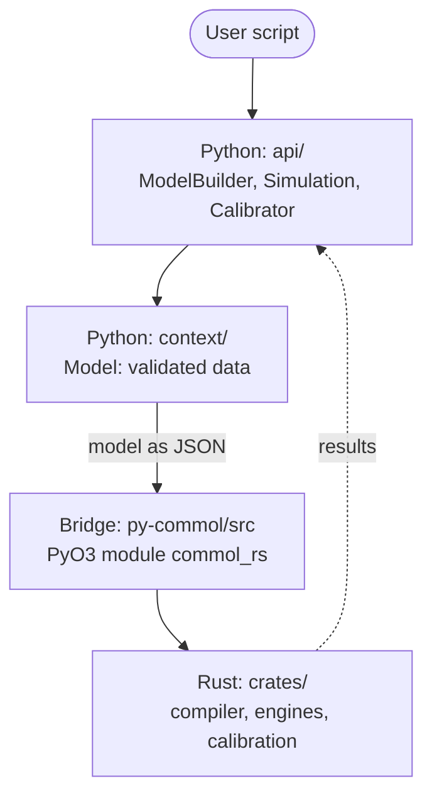
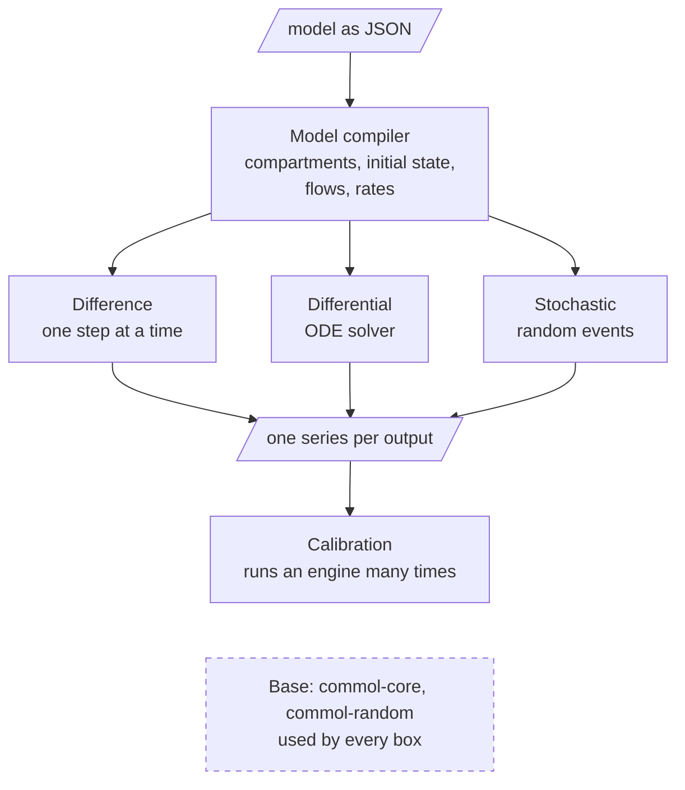
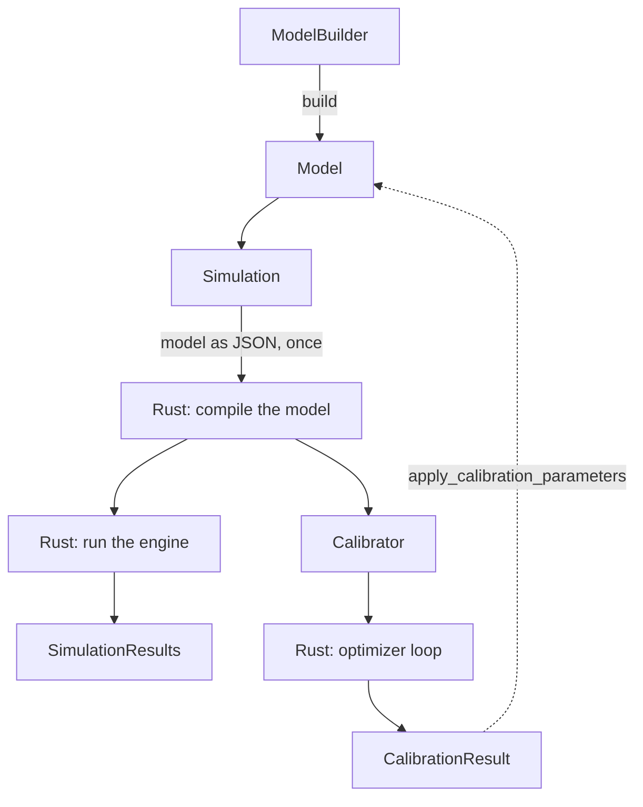

# Architecture

[Back to Codebase Guide](index.md)

This page shows how the code of Commol is put together, in three
diagrams. It is for a person who wants the big picture before reading files.
For the rules behind the picture, read the [Mental model](mental-model.md); to
find the file that owns a behavior, read the [Repository map](repository-map.md).

## The big picture

Commol has two halves. **Python** is the front: the user writes the model
there, and sees the results there. **Rust** is the back: it turns the model
into numbers.

| Half | Folder | Job |
|---|---|---|
| Python | `py-commol/commol/` | The public API (`api/`) and the model as validated data (`context/`). |
| Bridge | `py-commol/src/` | Exposes the Rust functions to Python (PyO3). |
| Rust | `crates/` | Every rule about how a model becomes numbers. |

**Golden rule:** Python never computes how a model expands or runs. It asks
Rust.

## Inside Rust

One compiler reads the model. Each engine runs the compiled model with its own
method and gives one series per output. Calibration runs an engine many times
and compares the series with the observations. The arrows show this flow, from
top to bottom. The dashed box is the base that every box uses.

| Box | Crate | Job |
|---|---|---|
| Model compiler | `commol-model` | Expands the model into compartments, builds the initial state, plans the flows and compiles the rates. |
| Difference | `commol-difference` | Adds the change of each step: `X += derivatives`. |
| Differential | `commol-differential` | Integrates the ODEs with `diffsol`. |
| Stochastic | `commol-stochastic` | Moves whole units by random events. |
| Calibration | `commol-calibration` | Finds the values that make an engine match observations. |

Every box uses `commol-core` (shared types, rate formulas, the
`SimulationEngine` trait). The stochastic engines and calibration also use
`commol-random` (random numbers). Calibration works through the
`SimulationEngine` trait, so it does not depend on a specific engine.

## The path of a simulation and a calibration

1. `ModelBuilder` (`api/model_builder.py`) collects the model, and `build`
   returns a validated `Model` (`context/model.py`).
2. `Simulation` (`api/simulation.py`) sends the model to Rust once, through
   `build_engine` (`context/_model/engine_state.py`). Rust compiles it.
3. Each `run` calls the Rust engine and returns `SimulationResults`
   (`api/results.py`).

4. `Calibrator` (`api/calibrator.py`) takes the compiled engine of a
   `Simulation` and gives it to Rust with the problem. The optimizer loop
   runs in Rust and returns a `CalibrationResult`.
5. `apply_calibration_parameters` writes the result back into the `Model`.

## Checklist

- [ ] Find the half of your change in [the big picture](#the-big-picture).
- [ ] If Python needs a rule of the model, add a binding to the bridge; do not
      write the rule in Python.
- [ ] If a crate is added or removed, update [Inside Rust](#inside-rust).
      `tests/docs/test_reference.py` fails when a crate under `crates/` is
      not named on this page.

## Navigation

Previous: [Mental model](mental-model.md) | Next: [Repository map](repository-map.md)
