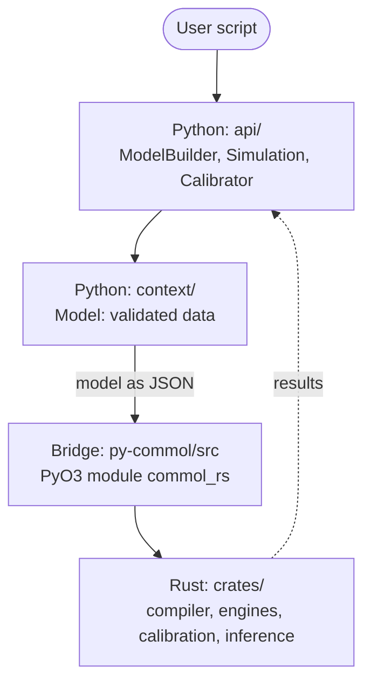
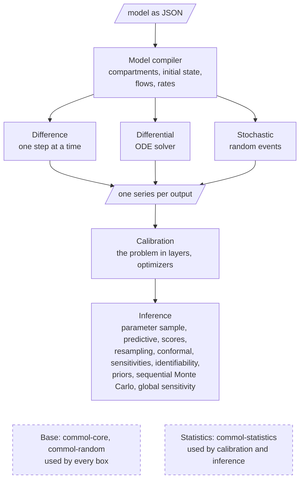
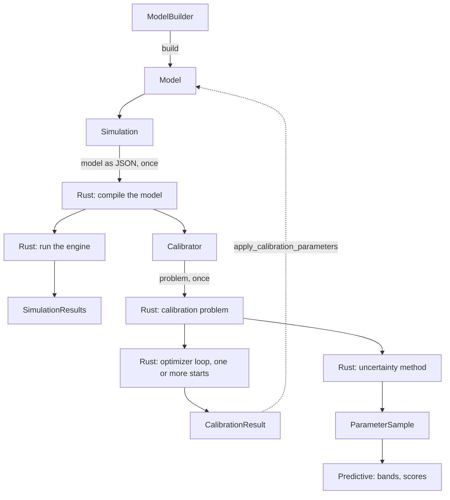

# Architecture

[Back to Codebase Guide](index.md)

This page shows how the code of Commol is put together, in three
diagrams. It is for a person who wants the big picture before reading files.
For the rules behind the picture, read the [Mental model](mental-model.md); to
find the file that owns a behavior, read the [Repository map](repository-map.md).

## The big picture

Commol has two halves. **Python** is the front: the user writes the model
there, and sees the results there. **Rust** is the back: it turns the model
into numbers.

| Half | Folder | Job |
|---|---|---|
| Python | `py-commol/commol/` | The public API (`api/`) and the model as validated data (`context/`). |
| Bridge | `py-commol/src/` | Exposes the Rust functions to Python (PyO3), and runs their parallel work in the thread pool of `commol.threads` (`parallel`). |
| Rust | `crates/` | Every rule about how a model becomes numbers, how it is calibrated, and how the uncertainty of a calibration is measured. |

**Golden rule:** Python never computes how a model expands or runs. It asks
Rust.

## Inside Rust

One compiler reads the model. Each engine runs the compiled model with its own
method and gives one series per output. Calibration runs an engine many times
and compares the series with the observations. Inference reads the
calibration problem to measure uncertainty. The arrows show this flow, from
top to bottom. The dashed boxes are shared: the base that every box uses, and
the statistics that calibration and inference use.

| Box | Crate | Job |
|---|---|---|
| Model compiler | `commol-model` | Expands the model into compartments, builds the initial state, plans the flows and compiles the rates. |
| Difference | `commol-difference` | Adds the change of each step: `X += derivatives`. |
| Differential | `commol-differential` | Integrates the ODEs with `diffsol`. |
| Stochastic | `commol-stochastic` | Moves whole units at random: events in continuous time, or a chain binomial draw per step. |
| Calibration | `commol-calibration` | The calibration problem in layers (forward model, observation operator, feasibility, discrepancy: a loss or the likelihood of observation models, optimization objective), and the optimizers that find the values that make an engine match observations, from one or several starts, or with one parameter or prediction held fixed (`Subproblem`). |
| Statistics | `commol-statistics` | One copy of each numerical helper (`log Σ exp`, `x ln y`, the special functions of the gamma family), of the log densities of the normal, the log-normal and the Student t, and of the weighted statistics: the one quantile of commol, the weighted summary of a column, the covariance and the effective size. It depends on no crate of commol. |
| Inference | `commol-inference` | What every uncertainty method returns or reads: the weighted parameter sample, the predictive of a sample, its observation noise and its scores; the resampling methods, which fit copies of the problem with other data (`CalibrationProblem::with_data`); the conformal prediction intervals; the port of sensitivities and the identifiability analyses; the distributions and priors, and the sequential Monte Carlo sampler with its targets (Gibbs posterior, ABC, the posterior of observation models); the noise, the parametric bootstrap and the log score of observation models; the input spaces, designs, quantities of interest and estimators of global sensitivity, which run on a forward model with no observations; the profile likelihood of parameters and predictions and its thresholds. It depends on calibration, never the reverse. |

Every box uses `commol-core` (shared types, rate formulas, the
`SimulationEngine` trait). The stochastic engines and calibration also use
`commol-random` (random numbers), and so does inference. Calibration and
inference also use `commol-statistics`, whose quantile the summary of the
replicates and every method of inference take. Calibration works
through the `SimulationEngine` trait, so it does not depend on a specific
engine; inference reaches an engine only through the forward model of a
calibration problem.

## The path of a simulation and a calibration

1. `ModelBuilder` (`api/model_builder.py`) collects the model, and `build`
   returns a validated `Model` (`context/model.py`).
2. `Simulation` (`api/simulation.py`) sends the model to Rust once, through
   `build_engine` (`context/_model/engine_state.py`). Rust compiles it.
3. Each `run` calls the Rust engine and returns `SimulationResults`
   (`api/results.py`).
4. `Calibrator` (`api/calibrator.py`) takes the compiled engine of a
   `Simulation` and builds the calibration problem in Rust once
   (`commol_rs.inference.CalibrationProblem`, `py-commol/src/inference.rs`).
   `run(starts=n)` runs the optimizer loop in Rust from each start, the
   starts and the particles of a swarm in parallel in the pool of
   `commol.threads`, and returns the best `CalibrationResult`.
5. `apply_calibration_parameters` writes the result back into the `Model`.
6. `Calibrator.uncertainty(method)` runs a method on the same problem. A method
   with draws returns a result that holds a `ParameterSample`; a `Predictive`
   (`api/inference/predictive.py`) runs its draws, and `commol.scores` checks
   them against observations.

## Checklist

- [ ] Find the half of your change in [the big picture](#the-big-picture).
- [ ] If Python needs a rule of the model, add a binding to the bridge; do not
      write the rule in Python.
- [ ] If a crate is added or removed, update [Inside Rust](#inside-rust).
      `tests/docs/test_reference.py` fails when a crate under `crates/` is
      not named on this page.

## Navigation

Previous: [Mental model](mental-model.md) | Next: [Repository map](repository-map.md)
