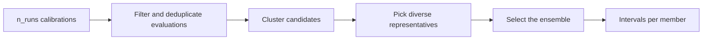

# Probabilistic Calibration

[Back to Model Calibration](calibration.md)

A single calibration gives one parameter set. A probabilistic calibration gives
an **ensemble**: many parameter sets that all fit the data, and from them,
prediction intervals and parameter spreads. Add a `probabilistic_config` to the
problem and call `Calibrator.run_probabilistic()`.

## Quick path

```python
import random

from commol import (
    CalibrationParameter,
    CalibrationProblem,
    Calibrator,
    ModelBuilder,
    ObservedDataPoint,
    ParticleSwarmConfig,
    ProbabilisticCalibrationConfig,
    ProbNsga2Config,
    Simulation,
)

def model(k1: float | None, k2: float | None):
    return (
        ModelBuilder(name="Ensemble")
        .add_bin(id="A", name="State A")
        .add_bin(id="B", name="State B")
        .add_bin(id="C", name="State C")
        .add_parameter(id="k1", value=k1)
        .add_parameter(id="k2", value=k2)
        .add_transition(id="t_ab", source=["A"], target=["B"], rate="k1 * A * B / total")
        .add_transition(id="t_bc", source=["B"], target=["C"], rate="k2 * B")
        .set_initial_conditions(
            total=1000,
            bin_fractions=[
                {"bin": "A", "fraction": 0.99},
                {"bin": "B", "fraction": 0.01},
                {"bin": "C", "fraction": 0.0},
            ],
        )
        .build(engine="DifferenceEquations")
    )

# Noisy observations of a model with k1 = 0.4, k2 = 0.1
truth = Simulation(model(0.4, 0.1)).run(num_steps=50)
noise = random.Random(1)
observed_data = [
    ObservedDataPoint(at=step, output="B", value=truth["B"][step] * (1 + noise.gauss(0, 0.05)))
    for step in range(5, 51, 5)
]

problem = CalibrationProblem(
    observed_data=observed_data,
    parameters=[
        CalibrationParameter(id="k1", parameter_type="parameter", min_bound=0.0, max_bound=1.0),
        CalibrationParameter(id="k2", parameter_type="parameter", min_bound=0.01, max_bound=1.0),
    ],
    optimization_config=ParticleSwarmConfig(num_particles=20, max_iterations=100),
    probabilistic_config=ProbabilisticCalibrationConfig(
        n_runs=8,
        ensemble_selection=ProbNsga2Config(
            ensemble_size_mode="bounded",
            ensemble_size_min=5,
            ensemble_size_max=10,
            population_size=40,
            generations=30,
        ),
    ),
    seed=11,
)

result = Calibrator(Simulation(model(None, None)), problem).run_probabilistic()
ensemble = result.selected_ensemble

print(ensemble.ensemble_size)                            # 10
print({k: round(v, 2) for k, v in sorted(ensemble.point_parameters.items())})
# {'k1': 0.4, 'k2': 0.1}
print(ensemble.coverage_percentage)                      # 100.0: every observation inside the band
k1 = ensemble.parameter_statistics["k1"]
print(round(k1.percentile_lower, 2), round(k1.percentile_upper, 2))  # the 95% interval of k1
```

The settings above are small so the example is fast. For real work, see
[A recommended configuration](#a-recommended-configuration).

## How the ensemble is built



1. **Runs.** The optimizer runs `n_runs` times, from different random starts,
   and every evaluation it makes is kept.
2. **Filter.** Duplicate parameter sets are removed, and only near-optimal ones
   are kept (`evaluation_processing`).
3. **Cluster.** Candidates are grouped in parameter space or in the space of the
   predictions that are compared with data (`clustering`).
4. **Representatives.** Diverse candidates are taken from each cluster
   (`representative_selection`).
5. **Selection.** NSGA-II (default) or a fit-gated greedy search picks the final
   members, balancing narrow intervals and coverage of the observations
   (`ensemble_selection`).
6. **Intervals.** Each member's predictions are computed with the observation's
   aggregates, windows and scale factors, and then reduced across members.

Every loss works (`"sse"`, `"rmse"`, `"mae"`): the ensemble is
scored with the same loss as the runs. Use `normalize_observations=True` when
series differ in size.

## Configuration

### `ProbabilisticCalibrationConfig`

| Field | Default | Meaning |
|---|---|---|
| `n_runs` | `10` | Independent calibrations. |
| `evaluation_processing` | `ProbEvaluationFilterConfig()` | Which evaluations become candidates. |
| `clustering` | `ProbClusteringConfig()` | How candidates are grouped. |
| `representative_selection` | `ProbRepresentativeConfig()` | How many candidates reach the selection, and which. |
| `ensemble_selection` | `ProbNsga2Config()` | The selection backend: `ProbNsga2Config` or `ProbGreedyLocalSearchConfig`. |
| `confidence_level` | `0.95` | The level of every interval. |
| `include_ensemble_candidates` | `False` | Adds the candidates and their losses to the result. |

### `ProbEvaluationFilterConfig`

| Field | Default | Meaning |
|---|---|---|
| `evaluation_retention` | `"all"` | `"all"`, `"best_per_run"` or `"top_k_per_run"` evaluations of each run. |
| `top_k_per_run` | `None` | How many, with `"top_k_per_run"`. |
| `max_loss_ratio` | `None` | Keeps only evaluations whose loss is at most this times the best one: the core pool. |
| `tail_max_loss_ratio`, `tail_max_representatives` | `None`, `0` | A wider loss band from which up to that many candidates are added, only if their predictions are new. |
| `loss_percentile_filter` | `1.0` | Keeps this best fraction, by loss. |
| `deduplication_tolerance` | `1e-6` | Parameter sets closer than this are duplicates. |
| `min_evaluations_required` | `5` | The minimum number of unique evaluations the analysis needs. |

### `ProbClusteringConfig`

| Field | Default | Meaning |
|---|---|---|
| `feature_space` | `"parameters"` | `"parameters"`, or `"observed_predictions"` to cluster what is compared with data (windows, aggregates and scale factors included). |
| `n_clusters` | `None` | `None` chooses it by silhouette score, up to `max_k` (`10`). |
| `min_evaluations_for_clustering` | `100` | Below it, no clustering. |
| `silhouette_threshold`, `silhouette_excellent_threshold` | `0.2`, `0.8` | When clustering helps, and when to stop searching. |
| `kmeans_algorithm`, `kmeans_max_iter` | `"elkan"`, `100` | K-means settings. |
| `silhouette_sample_size`, `minibatch_kmeans_threshold` | `None` | Speed settings for many evaluations. |
| `identical_solutions_atol` | `1e-10` | Tolerance for identical solutions. |

### `ProbRepresentativeConfig`

| Field | Default | Meaning |
|---|---|---|
| `max_representatives` | `1000` | Candidates passed to the selection. |
| `percentage_elite_cluster_selection` | `0.1` | Share of each cluster's best solutions always included. |
| `cluster_representative_strategy` | `"proportional"` | `"proportional"` or `"equal"` representatives per cluster. |
| `cluster_selection_method` | `"latin_hypercube"` | `"latin_hypercube"`, `"crowding_distance"` or `"maximin_distance"`. |
| `quality_temperature`, `sparsity_weight` | `1.0`, `2.0` | `"maximin_distance"` weighting. |
| `k_neighbors_min`, `k_neighbors_max` | `5`, `10` | Density estimate. |
| `stratum_fit_weight` | `10.0` | `"latin_hypercube"` weighting. |

### Ensemble selection

Both backends share the size settings:

| Field | Default | Meaning |
|---|---|---|
| `ensemble_size_mode` | `"automatic"` | `"fixed"`, `"bounded"` or `"automatic"`. |
| `ensemble_size` | `None` | The size, with `"fixed"`. |
| `ensemble_size_min`, `ensemble_size_max` | `None` | The range, with `"bounded"`. |

| `ProbNsga2Config` field | Default | Meaning |
|---|---|---|
| `population_size`, `generations` | `100`, `100` | NSGA-II effort. |
| `crossover_probability` | `0.9` | NSGA-II crossover. |
| `pareto_preference` | `0.5` | Which Pareto solution is reported: towards narrow intervals or towards coverage. |

| `ProbGreedyLocalSearchConfig` field | Default | Meaning |
|---|---|---|
| `central_fit_max_loss_ratio` | `1.25` | Rejects an ensemble whose median prediction loses more than this times the best member. |
| `search_beam_width` | `32` | Partial ensembles kept per size; more is wider and slower. |

### A recommended configuration

```python
from commol import (
    ProbClusteringConfig,
    ProbEvaluationFilterConfig,
    ProbGreedyLocalSearchConfig,
    ProbRepresentativeConfig,
)

recommended = ProbabilisticCalibrationConfig(
    n_runs=75,
    evaluation_processing=ProbEvaluationFilterConfig(
        evaluation_retention="top_k_per_run",
        top_k_per_run=100,
        max_loss_ratio=1.25,
        tail_max_loss_ratio=2.0,
        tail_max_representatives=50,
    ),
    clustering=ProbClusteringConfig(feature_space="observed_predictions"),
    representative_selection=ProbRepresentativeConfig(
        max_representatives=1000,
        percentage_elite_cluster_selection=0.5,
        cluster_selection_method="maximin_distance",
    ),
    ensemble_selection=ProbNsga2Config(
        ensemble_size_mode="bounded",
        ensemble_size_min=15,
        ensemble_size_max=30,
        population_size=100,
        generations=100,
        pareto_preference=0.5,
    ),
)

# The fit-gated alternative to NSGA-II
greedy = ProbGreedyLocalSearchConfig(
    ensemble_size_mode="bounded",
    ensemble_size_min=15,
    ensemble_size_max=30,
    central_fit_max_loss_ratio=1.25,
    search_beam_width=32,
)
```

Raise `n_runs`, particles and iterations before you relax the loss gates. If
the intervals are narrow because every near-optimal candidate predicts the same,
prefer a small prediction-novel tail (`tail_max_*`) over a larger
`max_loss_ratio`: a wider band only helps when its members still fit the data.

## Reading the result

| `ProbabilisticCalibrationResult` field | Meaning |
|---|---|
| `selected_ensemble` | The `EnsembleSolution` below. |
| `selection_algorithm` | `"nsga2"` or `"greedy_local_search"`. |
| `pareto_front`, `selected_pareto_index` | NSGA-II only: the Pareto summaries (`EnsembleSelectionSummary`) and the reported one. |
| `n_runs_performed`, `n_unique_evaluations`, `n_clusters_used` | What the pipeline did. |
| `confidence_level` | The interval level. |
| `stage_timings`, `stage_counts` | Seconds and counts per stage. |
| `ensemble_candidates` | With `include_ensemble_candidates=True`. |

| `EnsembleSolution` field | Meaning |
|---|---|
| `point_parameters`, `point_loss` | The lowest-loss member: the only parameter set that describes one calibrated model. |
| `ensemble_parameters`, `ensemble_size` | Every member. |
| `parameter_statistics` | Per parameter: `mean`, `median`, `std`, `percentile_lower`, `percentile_upper`, `min`, `max`. |
| `prediction_positions` | The positions of the prediction series: the unit grid up to one past the last observation, and every observation position and window start. |
| `prediction_median`, `prediction_ci_lower`, `prediction_ci_upper` | Per output, one value per position of `prediction_positions`. |
| `windowed_prediction_*` | The same for windowed observations, at the positions in `windowed_prediction_positions`. |
| `coverage_percentage`, `average_ci_width` | Share of observations inside the band, and the band's mean width. |
| `central_loss` | The loss of the member-wise median prediction. |
| `observation_diagnostics` | Coverage and width **per observed series**. |
| `selection_diagnostics` | Why the selection stopped where it did. |

```python
print(ensemble.observation_diagnostics["B"]["coverage_percentage"])  # 100.0
```

!!! warning "Use `point_parameters` to build a model"
    `apply_calibration_parameters` applies `point_parameters`. Do not combine
    the parameter medians into a model: that parameter set may never have been
    calibrated and need not fit the data.

Check `observation_diagnostics` for every series: a good overall coverage can
hide a poor fit of a small series.

## Your own ensemble statistics

Simulate each member, reduce each run to the quantity you need, **then** take
statistics across members with `member_statistics`:

```python
from commol import ci_percentiles, member_statistics

final_c = [
    Simulation(model(member["k1"], member["k2"])).run(num_steps=50)["C"][-1]
    for member in ensemble.ensemble_parameters
]
stats = member_statistics(final_c, result.confidence_level)
print(sorted(stats))  # ['ci_lower', 'ci_upper', 'max', 'mean', 'median', 'min']

print(ci_percentiles(0.95))  # the percentile points of a 95% interval: about (2.5, 97.5)
```

`member_statistics` also accepts equal-length series and reduces them position
by position.

!!! warning "Reduce each member first"
    Bands of raw trajectories, reduced afterwards, give a difference of
    percentiles: an interval that no member realizes, and usually a wider one.
    `windowed_prediction_*` already follow this rule.

## Next steps

| To learn | Read |
|---|---|
| Reporting an ensemble | [Reports](reports.md) |
| Plotting the band | [Plotting](simulations.md#plotting) with `calibration_result=` |
