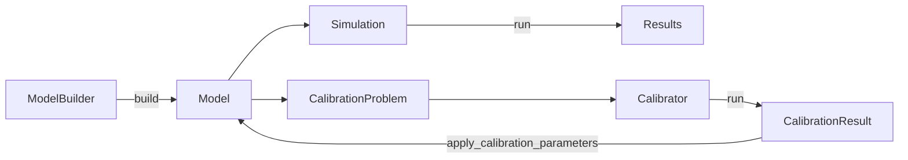

# Commol

Commol builds, simulates and calibrates compartment models: a population moves
between states (compartments) at rates you write as formulas. You describe the
model in Python; a Rust engine expands it over your stratifications, compiles
every rate to machine code, and runs it or fits it to your data.

!!! warning "Before version 1.0"
    The API can change between minor versions (`0.2` → `0.3`). The
    [changelog](about/changelog.md) marks every change that breaks code as
    **Breaking**.

## Where to go

| You are… | Start with | Then |
|---|---|---|
| New to Commol | [Quick Start](getting-started/quickstart.md) | [Core Concepts](guide/core-concepts.md) |
| Building a model | [Building Models](guide/building-models.md) | [Transitions](guide/transitions.md), [Mathematical Expressions](guide/mathematical-expressions.md) |
| Fitting a model to data | [Model Calibration](guide/calibration.md) | [Probabilistic Calibration](guide/probabilistic-calibration.md) |
| Looking up a class or argument | [API Reference](api/index.md) | [Model Structure](advanced/model-structure.md) |
| Contributing to Commol | [Codebase Guide](codebase/index.md) | [Development Workflow](development/workflow.md) |
| An AI agent using Commol | <a href="llms.txt"><code>llms.txt</code></a>: an index of the site | <a href="llms-full.txt"><code>llms-full.txt</code></a>: the whole site in one file |
| An AI agent changing Commol | [`AGENTS.md`](https://github.com/MUNQU/commol/blob/develop/AGENTS.md) | [Codebase Guide](codebase/index.md) |

## How Commol works



1. **Build** a `Model` with `ModelBuilder`: bins, parameters, transitions,
   stratifications and initial conditions. Commol validates it as you go.
2. **Simulate** it with `Simulation`: one series per compartment and
   accumulator.
3. **Calibrate** unknown values against observations with `Calibrator`, and
   write the result back into the model.

## Quick example

```python
from commol import ModelBuilder, Simulation

model = (
    ModelBuilder(name="Basic Model")
    .add_bin(id="A", name="State A")
    .add_bin(id="B", name="State B")
    .add_bin(id="C", name="State C")
    .add_parameter(id="k1", value=0.3)
    .add_parameter(id="k2", value=0.1)
    .add_transition(id="t_ab", source=["A"], target=["B"], rate="k1 * A * B / N")
    .add_transition(id="t_bc", source=["B"], target=["C"], rate="k2")
    .set_initial_conditions(
        population_size=1000,
        bin_fractions=[
            {"bin": "A", "fraction": 0.99},
            {"bin": "B", "fraction": 0.01},
            {"bin": "C", "fraction": 0.0},
        ],
    )
    .build(engine="DifferenceEquations")
)

results = Simulation(model).run(num_steps=100)
```

## Features

| Feature | Guide |
|---|---|
| Fluent, validated model building | [Building Models](guide/building-models.md) |
| Stratifications, conditional stratifications, per-compartment initial conditions | [Core Concepts](guide/core-concepts.md#stratifications) |
| Rate formulas compiled with Cranelift | [Mathematical Expressions](guide/mathematical-expressions.md) |
| Pulses, windows, ramps, seasons and schedules per subgroup | [Axis Patterns](guide/axis-patterns.md) |
| Unit checking and equation output (text, LaTeX) | [Units and Equations](guide/units-and-equations.md) |
| Calibration of parameters, initial conditions and scale factors | [Model Calibration](guide/calibration.md) |
| Ensembles and prediction intervals | [Probabilistic Calibration](guide/probabilistic-calibration.md) |
| JSON-ready reports and seaborn plots | [Reports](guide/reports.md), [Plotting](guide/simulations.md#plotting) |

## License and authors

Commol is licensed under the MIT License; see [License](about/license.md). It
is developed by the MUNQU team: Rafael J. Villanueva Micó, Carlos Andreu
Vilarroig and David Martínez Rodríguez.
