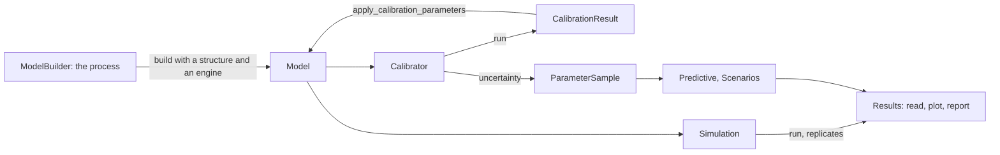

# Commol

Commol builds, simulates and calibrates compartment models: amounts move
between states (compartments) at rates you write as formulas. An amount can be
a count, a mass or a concentration. You describe the process once, in Python,
and choose the engine that runs it: difference equations, differential
equations or a stochastic process of whole units. A Rust engine expands the
model over your stratifications, compiles every rate to machine code, runs it,
fits it to your data and measures how sure the fit is.

!!! warning "Before version 1.0"
    The API can change between minor versions (`0.2` → `0.3`). The
    [changelog](about/changelog.md) marks every change that breaks code as
    **Breaking**.

## Where to go

| You are… | Start with | Then |
|---|---|---|
| New to Commol | [Quick Start](getting-started/quickstart.md) | [Core Concepts](guide/core-concepts.md) |
| Building a model | [Building Models](guide/building-models.md) | [Transitions](guide/transitions.md), [Mathematical Expressions](guide/mathematical-expressions.md) |
| Running a model | [Running Simulations](guide/simulations.md) | [Stochastic Simulation](guide/stochastic.md) |
| Fitting a model to data | [Model Calibration](guide/calibration.md) | [Uncertainty](guide/uncertainty/index.md) |
| Looking up a class or argument | [API Reference](api/index.md) | [Model Structure](advanced/model-structure.md) |
| Contributing to Commol | [Codebase Guide](codebase/index.md) | [Development Workflow](development/workflow.md) |
| An AI agent using Commol | <a href="llms.txt"><code>llms.txt</code></a>: an index of the site | <a href="llms-full.txt"><code>llms-full.txt</code></a>: the whole site in one file |
| An AI agent changing Commol | [`AGENTS.md`](https://github.com/MUNQU/commol/blob/main/AGENTS.md) | [Codebase Guide](codebase/index.md) |

## How Commol works



1. **Build** the process once with `ModelBuilder`: bins, parameters,
   transitions, stratifications and accumulators. `build` joins it with a
   structure (the amount each bin starts with) and an engine, and checks the
   whole definition.
2. **Run** it with `Simulation`. The same process runs as difference
   equations, as differential equations or as a stochastic process of whole
   units; only the engine changes.
3. **Read** the results by output name, and draw or report them with their
   own methods (`results.plot`, `results.report`).
4. **Calibrate** the unknown values against observations with `Calibrator`,
   and write the result back into the model.
5. **Quantify** how sure the fit is: an uncertainty method gives a sample of
   the parameters, and its predictive gives bands and scores.
6. **Compare** runs: `Scenarios` runs a sample under other parameter values,
   and `plot_compared` draws several results on the same panels.

Every parallel step (the starts of a calibration, the replicates, the draws
of a predictive) runs in Rust on the threads you choose.

## Quick example

One process, run by two engines:

```python
from commol import Aggregate, ModelBuilder, Simulation

process = (
    ModelBuilder(name="Basic Model")
    .add_bin(id="A", name="State A")
    .add_bin(id="B", name="State B")
    .add_bin(id="C", name="State C")
    .add_parameter(id="k1", value=0.3)
    .add_parameter(id="k2", value=0.1)
    .add_transition(id="t_ab", source=["A"], target=["B"], rate="k1 * A * B / total")
    .add_transition(id="t_bc", source=["B"], target=["C"], rate="k2")
)
structure = Aggregate(bin_amounts={"A": 990, "B": 10, "C": 0})

steps = Simulation(process.build(structure, engine="DifferenceEquations")).run(num_steps=100)
flows = Simulation(process.build(structure, engine="DifferentialEquations")).run(num_steps=100)
print(round(steps["C"][-1]), round(flows["C"][-1]))  # the amount of C in each model
```

## Features

| Feature | Guide |
|---|---|
| Fluent, checked model building | [Building Models](guide/building-models.md) |
| Stratifications, conditional stratifications, per-compartment initial conditions | [Core Concepts](guide/core-concepts.md#stratifications) |
| Rate formulas compiled with Cranelift | [Mathematical Expressions](guide/mathematical-expressions.md) |
| Pulses, windows, ramps, sinusoids and schedules per subgroup | [Axis Patterns](guide/axis-patterns.md) |
| Unit checking, and dates on the axis | [Units](guide/units-and-equations.md) |
| A description of a model: equations, state graphs, the ODD protocol (text, Markdown, LaTeX) | [Describing a Model](guide/describing-models.md) |
| One process run as difference equations or differential equations; results read, plotted and compared | [Running Simulations](guide/simulations.md) |
| The same process as a stochastic process of whole units, with seeds and replicates | [Stochastic Simulation](guide/stochastic.md) |
| Calibration of parameters, initial conditions and scale factors | [Model Calibration](guide/calibration.md) |
| Parameter samples, predictive bands, scenarios and scores | [Uncertainty](guide/uncertainty/index.md) |
| JSON-ready reports | [Reports](guide/reports.md) |
| Parallel starts, replicates, particles and draws, on the threads you choose | [Threads and Parallelism](guide/parallelism.md) |

## License and authors

Commol is licensed under the MIT License; see [License](about/license.md). It
is developed by the MUNQU team: Rafael J. Villanueva Micó, Carlos Andreu
Vilarroig and David Martínez Rodríguez.
