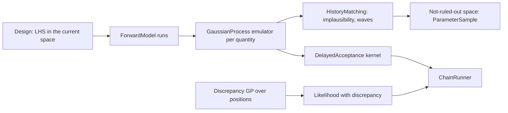

# Feature: emulators, history matching and model discrepancy

Issue: [#139](https://github.com/MUNQU/commol/issues/139), which holds the status, the dependencies and the pull request.

Goal: Gaussian-process emulators of slow models, and three methods on them:
history matching, which rules out inputs that cannot match the data, delayed
acceptance, which lets an emulator screen MCMC proposals, and the model
discrepancy of Kennedy and O'Hagan, which states the structural error of a
model inside its likelihood.
Motivation: the user wants as many techniques as possible
(`inference-foundation.md` L2). Every earlier method assumes the model is
cheap enough to run thousands of times and is right up to noise; agent and
network models (`odd/README.md`) break the first, and every model
breaks the second to some degree.
Program: last of fourteen; follows the architecture of
`odd/inference-foundation.md`; reads the quantities of interest and
designs of `odd/sensitivity-analysis.md`, the likelihood of
`odd/observation-models.md` and the chains of
`odd/mcmc-samplers.md`.
Branch: `feat/emulation-discrepancy` from `develop`, after
`model-comparison.md` is merged.
Engram mirror: topic `odd/emulation-discrepancy/tasks` (project `commol`).
Runners: the Rust tests, clippy and rustdoc (from the root), `maturin develop
--release --features test-kind`, then `pytest`, `pytest -m docs`, `ruff check
.`, `ty check commol` and `vulture` (from `py-commol/`), `mkdocs build
--strict` (from the root).

## Current state (verified 2026-10-15 on `develop` at `20a61a6`)

- No emulator or discrepancy term exists.
- After the earlier ODDs: `QuantityOfInterest`, Latin-hypercube designs,
  `PolynomialChaos` (a surrogate), `Likelihood` with observation models,
  `ChainRunner` and `Kernel`, `IdentifiabilityReport`, `nalgebra`.

## Architecture

- `GaussianProcess` (`commol-inference/src/gp/`) is one component: kernels,
  mean functions, hyperparameter fit, prediction and its own validation.
  History matching, delayed acceptance and discrepancy all use it.
- An emulator stands for one `QuantityOfInterest`; history matching and
  delayed acceptance hold one emulator per quantity they need.
- The discrepancy is an observation model with a correlated term, so it
  plugs into `Likelihood` and every likelihood method runs it.

## Specs

Every spec follows the [documentation definition of done](../docs/codebase/conventions.md#documentation-definition-of-done).

### S1 — Gaussian-process emulator

- Fix (D1): `GaussianProcess(kernel, mean)`: squared-exponential and Matérn
  5/2 kernels with one length scale per input, constant or linear mean, a
  nugget, hyperparameters by maximum marginal likelihood from several starts
  (argmin's L-BFGS), Cholesky prediction of mean and variance.
- Fix: `validate()` gives leave-one-out standardized errors and the
  diagnostics of Bastos and O'Hagan (2009); an emulator that fails them is
  reported, not used silently.
- Check: on a known smooth function, predictions and variances are
  calibrated (standardized errors near standard normal); the emulator
  interpolates its design points with no nugget.

### S2 — History matching

- Fix (D2): `HistoryMatching(inputs, quantities, observations, cutoff,
  waves, design_size)` (Vernon, Goldstein and Bower 2010; Andrianakis et al.
  2015): each wave fits emulators on a Latin-hypercube design inside the
  current not-ruled-out space, computes the implausibility
  `I = |z − E[f]| / √(V_obs + V_disc + V_emu)` per quantity, and keeps inputs
  whose largest implausibility is below `cutoff` (required). Observation and
  discrepancy variances are required inputs.
- Fix: the result is `HistoryMatchingResult(waves, space)`: per wave, the
  emulators, the fraction of the space kept and its diagnostics; `space` is a
  uniform `ParameterSample` of the final not-ruled-out space, which can feed
  any later method as its starts or its prior support.
- Check: on a model with a known region of good fit, the waves converge to a
  space that contains it and excludes a far region.

### S3 — Delayed acceptance

- Fix: `DelayedAcceptance(kernel, emulator)` (Christen and Fox 2005): a
  `Kernel` that first accepts or rejects a proposal with the emulator's
  target, and runs the model only for proposals that pass, with the second
  test that keeps the exact target invariant.
- Check: the chain's moments equal those of the plain kernel on the same
  target; the number of model runs falls.

### S4 — Model discrepancy

- Fix (D3): `WithDiscrepancy(kernel, variance, length_scale)` wraps a
  `Normal` observation model of a series: the observations are the model plus
  a Gaussian process over positions plus noise (Kennedy and O'Hagan 2001); the
  likelihood is multivariate normal with covariance `K_δ + σ²I`. Its
  hyperparameters are `NOISE` parameters.
- Fix: the guide and the identifiability report warn that a flexible
  discrepancy can absorb the effect of physical parameters (Brynjarsdóttir and
  O'Hagan 2014); `identifiability.md` gains a check of that confounding (the
  collinearity of S3 there, with the discrepancy's basis as extra columns).
- Check: data from a model with a known smooth bias give an unbiased
  parameter with the discrepancy and a biased one without.

### S5 — Documentation

- Fix: `docs/guide/uncertainty/emulation.md`: when a model is slow enough to
  need an emulator, history matching against calibration, delayed acceptance,
  the discrepancy and its confounding; rows in the table of
  `uncertainty/index.md`.
- Check: `pytest -m docs`, `mkdocs build --strict`.

## Decisions (the user's to make)

Each row says why the recommendation beats each alternative.

| ID | Spec | Question | Recommendation | Why, against each alternative | Status |
|---|---|---|---|---|---|
| D1 | S1 | Own Gaussian process or a crate? | Own, in `commol-inference`, on `nalgebra`. | `egobox-gp`: complete, but brings `linfa` and `ndarray`, a second linear-algebra stack. `friedrich`: small, but unmaintained and without the diagnostics needed. The core is a Cholesky and a marginal likelihood, a few hundred lines. | proposed |
| D2 | S2 | Implausibility cutoff and variances | Required. | A default cutoff of 3 (Pukelsheim's rule): a modelling choice; the variances of observation and discrepancy are the user's knowledge, never the library's. | proposed |
| D3 | S4 | Which observation models take a discrepancy? | `Normal` only. | Any model: a Gaussian process under a Poisson or negative-binomial mean needs latent-variable inference, a larger piece. | proposed |
| D4 | S3 | Delayed acceptance in scope? | Yes. | Out: an emulator would serve history matching only; delayed acceptance is the step that makes posteriors of slow models affordable, with an exact result. | proposed |

## Tasks

| ID | Specs | Task | Route | Commit |
|---|---|---|---|---|
| T1 | S1 | Gaussian process, hyperparameters, validation | direct | |
| T2 | S2 | History matching | direct | |
| T3 | S3 | Delayed acceptance | direct | |
| T4 | S4 | Discrepancy, confounding check | direct | |
| T5 | S5 | Guide page | direct | |
| T6 | all | Final audit: every runner | direct | |

## Delivery

- Strategy: one PR to `develop`, squash-merged (`feat(inference): …`).
- Order: T1 → T2 → T3 → T4 → T5 → T6.
- Version impact: added. The benchmark (`library-benchmark.md`) follows
  the release that includes this ODD (`odd/README.md`).

## Evidence

(Filled during implementation.)

## Log

- L1 (user, 2026-10-15): see `inference-foundation.md` L1–L5.
