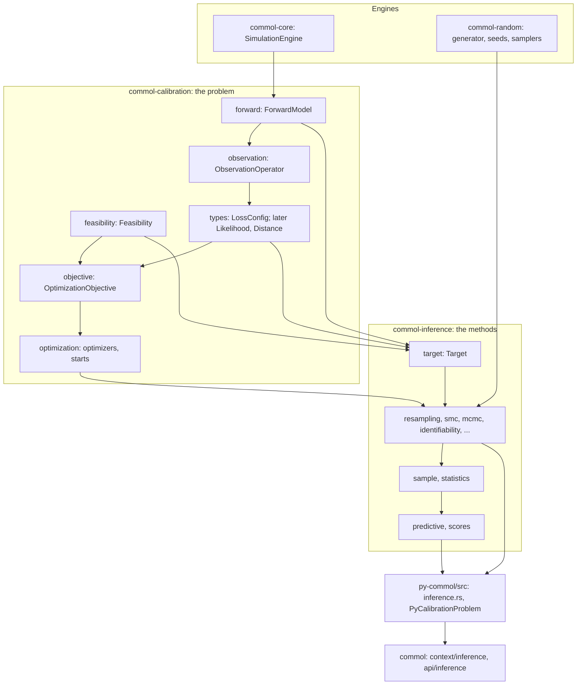

# Refactor: one calibration core for uncertainty and identifiability

Issue: [#125](https://github.com/MUNQU/commol/issues/125), which holds the status, the dependencies and the pull request.

Goal: split the calibration code into a small core that every uncertainty and
identifiability method uses (the forward model, the observation operator, the
feasibility check and the discrepancy), remove the ensemble selected by
coverage, and add what every later method returns or reads: a weighted
parameter sample, a predictive, scores, one entry point and a harness that
checks coverage.
Motivation: a review of the ensemble (L1) found that its intervals have no
statistical meaning, four bugs, and the observation operator written in four
places. The user wants as many uncertainty methods as possible (L2), with and
without a noise model (L3), and identifiability (L4), all before the benchmark,
with emphasis on the structure of the solution (L5).
Program: this ODD is the first of fourteen. The others build on its
architecture (section "Architecture") and never bypass it:

| Order | ODD | Adds |
|---|---|---|
| 1 | `inference-foundation.md` (this) | The core, the sample, the predictive, the scores, the entry point |
| 2 | `identifiability.md` | Sensitivities; structural, collinearity and sample-based identifiability |
| 3 | `resampling-uncertainty.md` | Bayesian, residual and wild block bootstrap; block jackknife |
| 4 | `conformal-prediction.md` | Split, jackknife+, adaptive and ensemble conformal intervals |
| 5 | `smc-inference.md` | One SMC core; Gibbs posterior on the loss; ABC-SMC; priors |
| 6 | `observation-models.md` | Noise models, likelihood, MLE, posterior predictive, parametric bootstrap |
| 7 | `profile-likelihood.md` | Parameter and prediction profiles; practical identifiability |
| 8 | `local-approximations.md` | Fisher, Laplace, delta method, sandwich, Laplace mixture with PSIS |
| 9 | `mcmc-samplers.md` | Adaptive Metropolis, DRAM, affine-invariant ensemble, DE-MCz, parallel tempering |
| 10 | `gradient-inference.md` | Exact derivatives, forward sensitivities, NUTS, ADVI |
| 11 | `state-space-inference.md` | Particle filter, PMMH, IF2, EnKF/EAKF, synthetic likelihood |
| 12 | `sensitivity-analysis.md` | Propagation, LHS-PRCC, Morris, Sobol, polynomial chaos |
| 13 | `model-comparison.md` | PSIS-LOO, LFO, WAIC, nested sampling, BMA, stacking |
| 14 | `emulation-discrepancy.md` | Gaussian-process emulators, history matching, model discrepancy, delayed acceptance |

Branch: `refactor/inference-foundation` from `develop`, after
`odd/model-kind-foundation.md` and `odd/stochastic-compartmental.md`
are merged (`odd/README.md`).
Engram mirror: topic `odd/inference-foundation/tasks` (project `commol`).
Runners: the Rust tests, clippy and rustdoc (from the root), `maturin develop
--release --features test-kind`, then `pytest`, `pytest -m docs`, `ruff check
.`, `ty check commol` and `vulture` (from `py-commol/`), `mkdocs build
--strict` (from the root).

## Current state (verified 2026-10-15 on `develop` at `20a61a6`)

`model-kind-foundation.md` S7 changes the calibration objective (replicates
with common random numbers, `replicate_summary` in `LossConfig`) before this
ODD runs. T1 reads `calibration_problem.rs` again after that merge.

### The calibration problem is one object with seven jobs

`CalibrationProblem<E>` (`crates/commol-calibration/src/calibration_problem.rs:48`)
holds and does all of these:

| Job | Fields or code |
|---|---|
| Engine template and writing values | `base_engine`, `values`, `configured_engine` (`:642`) |
| Observation operator: positions, sums of outputs, windows, scale factors | `observed_positions`, `observed_row_indices`, `observed_previous_row_indices`, `observed_output_indices`, `observed_factor_indices`; applied in `calculate_sparse_loss` (`:563`) |
| Normalization per series | `observed_normalization`, `compute_observation_normalization` (`:168`) |
| Loss | `loss_config` |
| Constraints and their penalties | `constraints`, `compiled_constraints`, `calculate_base_penalty`; the penalty scales with the largest observed value |
| History of evaluations | `evaluations: RwLock<…>`, written inside `cost` (`:901`) as a side effect |
| A shared result buffer | `result_buffer: RwLock<…>` |

`cost` (`:814`) mixes all of them: it returns a penalty for a constraint, an
infeasible start, an infeasible run or a non-finite value, and records the
evaluation. A sampler cannot use it: a penalty is a number on the loss scale,
not "outside the support".

### The ensemble pipeline

`Calibrator.run_probabilistic()` (`py-commol/commol/api/calibrator.py:454`) runs
`ProbabilisticCalibrator` (`api/probabilistic_calibrator.py`): `n_runs`
optimizations, every evaluation kept, deduplication, loss gates, K-means with
scikit-learn, representative selection, then NSGA-II or a greedy search that
optimizes interval width against coverage of the observations
(`crates/commol-calibration/src/probabilistic/ensemble/`). Its faults, verified
in this review:

- Method: no noise model; members are points the optimizer visited, not
  draws; the selection maximizes coverage of the data it was fitted to, so the
  reported coverage is the objective, not a check; `max_loss_ratio` has no
  statistical scale; NSGA-II (the default) has no constraint on the fit
  (`ensemble/mod.rs:140`); the greedy search ranks coverage first, so it aims
  at 100 %, not at the confidence level (`greedy.rs`, `choose_feasible`);
  95 % percentiles come from 5 to 30 members; the width is normalized by
  `|observed|.max(1.0)` (`ensemble/mod.rs:317`), which depends on the scale.
- B1: with `NelderMeadConfig`, every run is the same. `run_multiple_calibrations`
  sets a seed only for particle swarm (`probabilistic/calibration.rs:67`), and
  Nelder-Mead always starts at `initial_value()` (`types.rs:195`). Five runs of
  the guide's model gave the loss 432.643393173518 and the same parameters
  five times.
- B2: `collect_evaluations` falls back to `result.best_parameters`
  (`evaluation_processor.py:145`), a dict whose key order changes from run to
  run (seen in the same check), while `deduplicate` gives every evaluation the
  names of the first one (`:196`): values can land on the wrong parameter.
  `CalibrationResult.best_parameters` has the same unstable order for users.
- B3: the greedy `"automatic"` size stops at 25 members with no message
  (`greedy.rs:27`); the Rust documentation says "between two and all
  candidates".
- B4: a failed run is written to standard error (`probabilistic/calibration.rs:93`,
  `:104`) and dropped; Python logging never sees it, and the result does not
  say it.

### The observation operator lives in four places

Rust applies sums of outputs, windows and factors in `calculate_sparse_loss`.
Python does it again in `ensemble_selector.py:266` (`_generate_compact_predictions`,
`_apply_factor`), `statistics_calculator.py:320` (`_member_window_value`) and
`:519` (`_observation_member_values`, `_apply_factor`). The normalization is in
Rust and in `api/probabilistic/normalization.py`; both say "must stay
consistent" (`calibration_problem.rs:166`, `normalization.py:3`). This breaks
the golden rule of `AGENTS.md`.

### Other debts

- `EvaluationProcessor.select_representatives` writes prediction features
  into `CalibrationEvaluation.parameters` to reuse the Rust selector
  (`evaluation_processor.py:571`).
- `calculate_coverage_metrics` keeps a path that subtracts percentiles
  (`statistics_calculator.py:441`), which `docs/guide/probabilistic-calibration.md`
  forbids; no caller reaches it.
- `CalibrationRunner` (`api/probabilistic/calibration_runner.py:156` to `:273`)
  copies the conversion code of `Calibrator` (`calibrator.py:231` to `:346`).
- Every Rust call of the pipeline passes the engine, observations, parameters,
  constraints and loss again (seven arguments), because Python holds no handle
  to a built problem.
- `scikit-learn` is a runtime dependency (`pyproject.toml:36`) used only by the
  K-means of the pipeline.
- `SimulationPlotter._calibration_values` documents "median values for all
  parameters" (`api/plotter.py:414`) and returns `point_parameters`.
- No test checks that an interval covers the truth at its nominal rate.
- No crate has dense linear algebra for commol code; `nalgebra` and `faer`
  are compiled already, as `diffsol` features (`commol-differential`).

## Architecture

Every ODD of the program follows this section. A change to it is a change to
this ODD, recorded in its Log.

| Layer | Owns | Never does |
|---|---|---|
| `ForwardModel<E>` | Cloning, resetting, writing values to and running an engine; replicates of a stochastic engine | Loss, penalties, history |
| `ObservationOperator` | Turning a run into one predicted value per observation: rows, sums of outputs, windows, factors | Comparing with data |
| `Feasibility` | Bounds, constraints, infeasible starts and runs, as `Feasible` or `Violation { amount }` | Penalties |
| Discrepancy (`LossConfig`, later `Likelihood` and `Distance`) | Comparing predicted with observed values, weights and normalization | Running engines |
| `OptimizationObjective<E>` | The argmin `CostFunction`: the only place that turns a `Violation` into a penalty | Recording history |
| `Target` (`commol-inference`) | `log_density(θ)`: `−∞` outside the support | Penalties |
| Methods (`commol-inference`) | One algorithm each, behind the entry point | Touching an engine except through `ForwardModel` |
| `ParameterSample`, statistics, `Predictive`, scores | What every method returns and every reader uses | Knowing which method made a sample |

Rules:

1. `commol-inference` depends on `commol-calibration`; never the reverse.
2. Only `ForwardModel` clones, resets, writes or runs an engine.
3. Only `ObservationOperator` turns a run into observed quantities, for the
   optimizer, every method, the predictive and the scores.
4. Only `OptimizationObjective` adds penalties. A method sees a `Violation` as
   outside the support (D7).
5. Python never transforms predictions: windows, sums, factors, normalization,
   quantiles and scores come from Rust.
6. Every random number of a method comes from the `commol-random` generator,
   seeded from `CalibrationProblem.seed` by the derivation of
   `model-kind-foundation.md` S6 (SplitMix64 of `seed + index`).
7. A method is three parts: a configuration (Pydantic, `context/inference/`),
   a runner (Rust, bound in `py-commol/src/inference.rs`) and a result
   (Pydantic, `context/inference/`). It registers its runner; the entry point
   knows no method (D4).
8. A result with parameter draws holds a `ParameterSample`. Plots, reports,
   the predictive and the scores read a `ParameterSample`, never the result of
   one method (D3).

## Specs

Every spec follows the [documentation definition of done](../docs/codebase/conventions.md#documentation-definition-of-done).

### S0 — Bugs

- Fix (B1, D9): starts of a multi-start optimization come from the run seed.
  The first start is the initial guess; start `i > 0` is row `i` of a Latin
  hypercube over the bounds, drawn with the run's generator. Nelder-Mead and
  particle swarm both use these starts.
- Fix (B2): Rust returns parameter values as an ordered list of
  `(name, value)` pairs; `CalibrationResult.best_parameters` keeps the order of
  `CalibrationProblem.parameters`. No code builds parameter vectors from a
  dict.
- Fix (B4): a failed run is part of the result (`failed_runs: list[str]` with
  each reason) and is logged through Python `logging` by the caller; no
  library code writes to standard error (a rule in `conventions.md`).
- Fix: the plotter docstring says what `_calibration_values` returns.
- B3 goes with the greedy search (S3).
- Check: five Nelder-Mead runs with five seeds start at five points and give
  different evaluation histories; two runs with one seed are equal;
  `best_parameters` keeps the problem order across runs; a run that fails
  appears in `failed_runs` and in a captured log record.

### S1 — The problem core

- Fix: `CalibrationProblem<E>` splits into the layers of "Architecture", one
  module each in `commol-calibration` (`forward.rs`, `observation.rs`,
  `feasibility.rs`, `objective.rs`). `CalibrationProblem` remains as the value
  that holds them, built once, with no interior mutability.
- Fix: the history of evaluations is an argmin observer, not a write inside
  `cost`; `optimize_with_history` adds it.
- Fix: a `Workspace` per thread holds the result buffer; no `RwLock` guards a
  buffer.
- Fix: `ForwardModel::run_observed(θ, &mut Workspace) -> Result<&[f64], Violation>`
  returns one predicted value per observation; `run_at(θ, positions)` returns
  rows. With a stochastic engine both take the replicate seeds of
  `model-kind-foundation.md` S7.
- Check: every existing calibration test passes unchanged in its values; a
  test builds each layer alone; the loss of `OptimizationObjective` equals the
  loss of today's `cost` on the reference models (`tests/reference_models/`);
  clippy finds no `RwLock` in `commol-calibration`.

### S2 — One observation operator

- Fix: Python files that transform predictions go: `normalization.py` and the
  transforms of `ensemble_selector.py` and `statistics_calculator.py`.
- Fix: `PyCalibrationProblem` (`py-commol/src/inference.rs`) is built once from
  a `Calibrator` and passed to every Rust call; the conversion code lives
  once, in `Calibrator` (it replaces `CalibrationRunner`).
- Fix: Rust exposes, in parallel over parameter sets,
  `predict_observations(θs) -> [n_sets × n_observations]` and
  `predict_positions(θs, positions) -> [n_sets × n_positions × n_outputs]`.
- Check: `grep` finds no `window`, `factor_id` or normalization arithmetic in
  `py-commol/commol/api/`; the predicted observations of a model with sums,
  windows and a factor equal the values the loss compares.

### S3 — The ensemble goes

- Fix (D2): `crates/commol-calibration/src/probabilistic/`,
  `api/probabilistic_calibrator.py`, `api/probabilistic/` (except what S5 moves),
  `context/probabilistic_calibration.py`, `CalibrationProblem.probabilistic_config`,
  `Calibrator.run_probabilistic` and the `scikit-learn` dependency go, with
  their tests and `docs/guide/probabilistic-calibration.md`.
- Fix: `Calibrator.run(starts=n)` runs `n` starts (S0) in parallel and returns
  the best `CalibrationResult`, which gains `starts: list[StartSummary]` (start
  point, end point, loss, converged). Distinct ends with equal losses are a
  sign of non-identifiability; `identifiability.md` reads them.
- Fix: the changelog maps `run_probabilistic` to
  `Calibrator.uncertainty(BayesianBootstrap(...))`
  (`resampling-uncertainty.md`), the closest method with no noise model.
- Check: the package imports with no `sklearn`; `vulture` finds no orphan;
  `uv build` runs.

### S4 — The parameter sample

- Fix: `ParameterSample` in Rust (`commol-inference/src/sample.rs`) and Python
  (`context/inference/sample.py`): `names` (the problem order), `values`
  (`n_draws × n_parameters`), `log_weights` (normalized so the weights sum to
  1), `groups` (optional chain, replicate or wave of each draw) and `method`
  (name and settings of what made it).
- Fix: invariants checked at construction: finite values inside the bounds,
  finite log weights, one name per column.
- Fix: statistics, all weighted and computed in Rust: `mean`, `covariance`,
  `correlation`, `quantiles(levels)`, `interval(confidence_level)`,
  `effective_size` (Kish); `draws()` yields one mapping per draw;
  `resample(n, seed)` draws by weight.
- Fix: `apply_calibration_parameters` accepts a mapping or a
  `CalibrationResult`. A sample has no single parameter set: passing one
  raises `TypeError` and names `sample.draws()`.
- Check: weighted statistics equal closed forms on hand-made samples; equal
  weights give the unweighted values; a sample saved to JSON loads back equal.

### S5 — One quantile convention

- Fix (D5): `commol-inference/src/statistics.rs` holds the only quantile:
  the inverse of the weighted empirical distribution, interpolated between the
  midpoints of the cumulative weights. With equal weights it equals NumPy's
  `method="hazen"`.
- Fix: `ci_percentiles` and `member_statistics` move to
  `commol/api/inference/intervals.py`; `member_statistics` takes
  `weights=None` and calls the Rust quantile; "One confidence-interval
  convention" in `design-decisions.md` states the convention and the weights.
- Check: equal weights match `numpy.percentile(..., method="hazen")`; a
  weight of zero removes a member; two members with half the weight of a third
  give the quantiles of three equal members.

### S6 — The predictive

- Fix: `Predictive` (Rust `predictive.rs`, Python `api/inference/predictive.py`)
  holds, for a `ParameterSample` and positions, the trajectory of every draw,
  computed in parallel by `ForwardModel`. `band(confidence_level)` reduces
  draw by draw with the weights; `at_observations(observed_data)` gives every
  draw's value of each observation through `ObservationOperator`.
- Fix: an `ObservationNoise` port adds noise to draws. This ODD has
  `NoNoise` only; `resampling-uncertainty.md` adds empirical residuals and
  `observation-models.md` adds distributions. A band with noise is a
  prediction interval; without, a band of the model.
- Fix: `SimulationPlotter` and `simulation_report` take a `Predictive` where
  they took a `ProbabilisticCalibrationResult`.
- Check: the band of a sample of one draw is that draw; the weighted band
  equals `member_statistics` on the same values; plots and reports of a
  predictive run.

### S7 — Scores

- Fix: `commol-inference/src/scores.rs` and `commol.scores`: empirical
  coverage, interval score, weighted interval score (Bracher et al. 2021),
  CRPS of a weighted sample, PIT values (randomized for ties and discrete
  values), each per observation and per series. CRPS uses the one function of
  `LossConfig` (`model-kind-foundation.md` S7).
- Fix: scores take a `Predictive` and observations; which observations to
  hold out is the user's choice. The guide shows a split by position.
- Check: each score equals its closed form on a normal predictive; the
  sample CRPS of a known ensemble equals `E|X − y| − ½ E|X − X'|`.

### S8 — One entry point

- Fix (D4): `Calibrator.uncertainty(method: UncertaintyMethod[R]) -> R`.
  `UncertaintyMethod[R]` is a generic Pydantic base in `context/inference/`;
  each method's configuration subclasses it with its result type, and
  registers a runner in `api/inference/registry.py`. `uncertainty` looks up
  the runner by the configuration's type. A static type checker infers `R`
  from the argument's type, never from a value.
- Fix: the test kind registers a test method, so the entry point is tested
  with no real method.
- Check: `ty` infers the result type of the test method; an unregistered
  configuration raises and names the registered ones.

### S9 — Coverage studies

- Fix (D8): `tests/support/coverage.py` runs a method on `K` synthetic data
  sets made from known parameters and noise, and checks that the empirical
  coverage of each interval is inside a binomial tolerance of the nominal
  level. Tests that use it carry the marker `coverage_study`; `pytest`
  excludes them by default; `.github/workflows/coverage.yaml` runs them every
  week and on demand.
- Check: the harness accepts an oracle method that draws from the true
  posterior of a linear model and rejects one whose intervals are half as
  wide.

### S10 — Documentation

- Fix: `docs/guide/uncertainty/index.md` opens a guide section: the three
  questions (which parameters fit the data, how inputs move outputs, whether
  intervals are calibrated), the difference between a band of the model and a
  prediction interval, and a table "Which method answers which question",
  filled by each later ODD. `probabilistic-calibration.md` goes.
- Fix: `design-decisions.md` gets "One observation operator", "Constraints
  bound the support", "A sample carries its weights" and "Methods plug into
  one entry point"; "One meaning of an observation weight" loses the ensemble
  guards; "One confidence-interval convention" changes (S5).
- Fix: `repository-map.md` lists `commol-inference` and the new modules;
  `AGENTS.md` replaces the rows "Change probabilistic calibration" and
  "Change ensembles"; `maintainer-playbook.md` gets the checklist "Add an
  uncertainty method" (the three parts of rule 7, a coverage study, a guide
  page, a row in the table of `uncertainty/index.md`).
- Check: `pytest -m docs`, `mkdocs build --strict`.

## Decisions (the user's to make)

Each row says why the recommendation beats each alternative.

| ID | Spec | Question | Recommendation | Why, against each alternative | Status |
|---|---|---|---|---|---|
| D1 | S1, Architecture | Where do the methods live? | A new crate `commol-inference` on top of `commol-calibration`. | Modules inside `commol-calibration`: less boilerplate, but nothing stops a method from reaching into the problem's internals, and the crate mixes "what to fit" with "how to infer". Python: breaks the golden rule and loses `rayon`. A crate makes rule 1 a compiler error. | proposed |
| D2 | S3 | What happens to the ensemble? | Remove it in this ODD; no release until `resampling-uncertainty.md` merges, so no release lacks an uncertainty method. | Keep it until a replacement exists: S1 and S2 would have to port code that is then deleted. Keep it for good, renamed "diversity of fits": its 35 settings stay, and users would still read its bands as intervals. commol is alpha. | proposed |
| D3 | S4 | What does a method return? | Its own result type, which holds a `ParameterSample` when it has draws (`BootstrapResult(fit, sample, diagnostics)`). | One generic `ParameterSample[D]` for all: profiles, conformal intervals and jackknife estimates are not draws. A union type: every caller narrows it. | proposed |
| D4 | S8 | One entry point or many? | `Calibrator.uncertainty(method)`, generic in the result type, with a registry. | A method of `Calibrator` per technique: a class with thirty methods that every ODD edits. Free functions: each repeats the simulation and problem arguments. `method.run(calibrator)`: the configuration (in `context/`) would import `api/`. | proposed |
| D5 | S5 | Which quantile? | The weighted inverse distribution between midpoints of cumulative weights, for every interval; equal weights give NumPy's `hazen`. | Keep NumPy's default (`linear`) for equal weights and add another for weights: two conventions, and a sample with equal weights would change its interval when it gains weights. Harrell–Davis: smoother, but no simple weighted form and slower. Cost: today's intervals move slightly. | proposed |
| D6 | S4, S5 | Which dense linear algebra? | `nalgebra`, pinned to the version `diffsol` uses. | `faer`: faster on large matrices, but its API breaks between minor versions more often, and the matrices here are small (parameters × parameters, observations × parameters). Hand-written: Cholesky and SVD with good numerics are not worth writing. | proposed |
| D7 | S1 | How does a method see a constraint? | As the edge of the support: the log density is `−∞`. | A penalty: its scale is arbitrary (the largest observed value today), so a sampler would weigh infeasible points. Reject and draw again only: the same for samplers, but a profile or a Laplace fit needs the value. | proposed |
| D8 | S9 | When do coverage studies run? | With a marker, weekly and on demand in CI. | In every pull request: each study runs hundreds of fits, so CI would take tens of minutes. Only by hand: a regression would wait for someone to look. | proposed |
| D9 | S0 | Where does each start of a multi-start begin? | The initial guess, then rows of a Latin hypercube over the bounds. | Uniform draws: clusters and gaps with few starts. Small moves around the initial guess: every start falls in the same basin. | proposed |

## Tasks

| ID | Specs | Task | Route | Commit |
|---|---|---|---|---|
| T0 | S0 | Bugs B1, B2, B4 and the plotter docstring, with their tests, on the current code | direct | |
| T1 | S1 | Split `CalibrationProblem`; history as an observer; workspaces | direct | |
| T2 | S2 | `PyCalibrationProblem`; batch predictions; remove the Python transforms and `CalibrationRunner` | direct | |
| T3 | S3 | Remove the ensemble pipeline and `scikit-learn`; `run(starts=n)` | direct | |
| T4 | S4, S5 | `commol-inference`: `ParameterSample`, statistics, the quantile | direct | |
| T5 | S6, S7 | `Predictive`, `ObservationNoise`, scores; plotter and reports | direct | |
| T6 | S8 | `UncertaintyMethod`, registry, `Calibrator.uncertainty`, test method | direct | |
| T7 | S9 | Coverage harness, marker, weekly workflow | direct | |
| T8 | S10 | Documentation, changelog | direct | |
| T9 | all | Final audit: every runner | direct | |

## Delivery

- Strategy: one PR to `develop` from `refactor/inference-foundation`,
  squash-merged (`refactor(calibration): …`).
- Order: T0 → T1 → T2 → T3 → T4 → T5 → T6 → T7 → T8 → T9.
- Version impact: breaking (S3 removes `run_probabilistic` and its classes;
  S0 orders `best_parameters`). No release before
  `resampling-uncertainty.md` merges (D2).

## Evidence

(Filled during implementation.)

## Log

- L1 (user, 2026-10-15): asked for a critical review of how uncertainty is
  measured. The review found the faults of "Current state"; B1 was checked by
  running five Nelder-Mead calibrations.
- L2 (user, 2026-10-15): asked whether the ensemble can be repaired, and for
  as many uncertainty methods as possible, not only ABC-SMC.
- L3 (user, 2026-10-15): wants methods that need no a priori choice of the
  source of uncertainty (no noise model, no informative prior), next to
  methods that need one.
- L4 (user, 2026-10-15): added identifiability to the study.
- L5 (user, 2026-10-15): asked for the benchmark after all of this, and for
  ODDs with strong emphasis on the quality of the structure and architecture,
  as many as needed.
