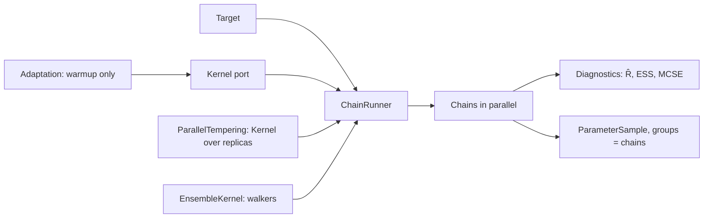

# Feature: Markov chain Monte Carlo samplers

Issue: [#134](https://github.com/MUNQU/commol/issues/134), which holds the status, the dependencies and the pull request.

Goal: gradient-free MCMC samplers for any target (the Gibbs posterior of a
loss, a likelihood posterior, later a synthetic or particle likelihood), with
the convergence diagnostics of current practice.
Motivation: the user wants as many uncertainty methods as possible
(`inference-foundation.md` L2). MCMC is the reference method for posteriors,
and `state-space-inference.md` (PMMH), `model-comparison.md` (nested
sampling moves) and `gradient-inference.md` (NUTS) build on its kernels and
diagnostics.
Program: ninth of fourteen; follows the architecture of
`odd/inference-foundation.md`; reuses the `Kernel` port and targets of
`odd/smc-inference.md` and `odd/observation-models.md`.
Branch: `feat/mcmc-samplers` from `develop`, after
`local-approximations.md` is merged.
Engram mirror: topic `odd/mcmc-samplers/tasks` (project `commol`).
Runners: the Rust tests, clippy and rustdoc (from the root), `maturin develop
--release --features test-kind`, then `pytest`, `pytest -m docs`, `ruff check
.`, `ty check commol` and `vulture` (from `py-commol/`), `mkdocs build
--strict` (from the root).

## Current state (verified 2026-10-15 on `develop` at `20a61a6`)

- No chain sampler exists.
- After the earlier ODDs: `Target`, `TemperedTarget`, the `Kernel` port with
  a random-walk kernel, `Distribution`, `ParameterSample.groups`,
  `ImportanceSampler`, the unconstrained transform of
  `local-approximations.md`.

## Architecture

- A kernel moves one state, or one ensemble of walkers, keeping the target
  invariant; `ChainRunner` owns warmup, draws, parallel chains and output.
  SMC moves (`smc-inference.md`) use the same kernels, so a kernel added here
  improves SMC too.
- Adaptation runs only during warmup and is then frozen, so the draws come
  from a fixed kernel.
- Diagnostics are functions of a `ParameterSample` with groups; any sampler,
  and users, can call them.

## Specs

Every spec follows the [documentation definition of done](../docs/codebase/conventions.md#documentation-definition-of-done).

### S1 — The chain runner

- Fix (D4): `ChainRunner(chains, warmup, draws, thin)`: `warmup` and `draws`
  are required; chains run in parallel on the unconstrained scale, each from
  its own generator stream and its own start (Latin-hypercube points of the
  prior, or draws of a given sample). The output is a `ParameterSample` with
  one group per chain.
- Check: on a standard normal target, means and variances match within the
  reported Monte Carlo error; two runs with one seed are equal.

### S2 — Kernels

- Fix: `AdaptiveMetropolis` (Haario, Saksman and Tamminen 2001): a Gaussian
  proposal whose covariance is learned in warmup.
- Fix: `Dram` (Haario et al. 2006): delayed rejection with a smaller second
  proposal, on top of adaptive Metropolis.
- Fix: `AffineInvariantEnsemble(walkers)` (Goodman and Weare 2010): stretch
  moves, with the red-blue split of Foreman-Mackey et al. (2013) so walkers
  move in parallel.
- Fix: `DifferentialEvolutionZ(snooker)` (ter Braak and Vrugt 2008): proposals
  from differences of past states, with optional snooker updates.
- Fix: `ParallelTempering(kernel, temperatures)` (replica exchange) over any
  kernel, with the ladder adapted in warmup (Vousden, Farr and Mandel 2016),
  for targets with separated modes.
- Check: each kernel on a correlated Gaussian and on a banana-shaped target
  matches the reference moments; parallel tempering visits both modes of a
  separated mixture in proportion, where adaptive Metropolis stays in one.

### S3 — Diagnostics

- Fix (D2): rank-normalized split `R̂`, bulk and tail effective sample size,
  and the Monte Carlo standard error of the mean and of quantiles (Vehtari et
  al. 2021), per parameter; acceptance rates and, for parallel tempering,
  swap rates.
- Fix: `McmcResult(sample, diagnostics)`; a parameter with `R̂ > 1.01` or a
  bulk effective size below 100 per chain is flagged in the result and the
  log.
- Check: the diagnostics equal the reference values of Vehtari et al. on
  stored chains; two chains stuck in different modes give a large `R̂`.

### S4 — Entry point and documentation

- Fix: `Mcmc(priors, kernel, chains, warmup, draws, target)` through
  `Calibrator.uncertainty`, where `target` is `"likelihood"` (needs
  observation models) or `Gibbs(eta)`.
- Fix: `docs/guide/uncertainty/mcmc.md`: which kernel for which shape, how to
  read the diagnostics; rows in the table of `uncertainty/index.md`.
- Check: `pytest -m docs`, `mkdocs build --strict`; coverage studies with the
  Gibbs and the likelihood targets.

## Decisions (the user's to make)

Each row says why the recommendation beats each alternative.

| ID | Spec | Question | Recommendation | Why, against each alternative | Status |
|---|---|---|---|---|---|
| D1 | S2 | Which kernels? | Adaptive Metropolis, DRAM, affine-invariant ensemble, DE-MCz, parallel tempering. | One kernel: no single gradient-free kernel handles correlated, curved and multimodal targets. More (slice, Hamiltonian): slice can join later as a kernel; Hamiltonian needs gradients (`gradient-inference.md`). | proposed |
| D2 | S3 | Where do diagnostics live? | Rust, in `commol-inference`. | ArviZ: a large Python dependency; SMC and PMMH need them in Rust anyway. | proposed |
| D3 | S1 | How do chains start? | Spread points of the prior, or draws of a given sample. | All at the fit: `R̂` cannot detect a second mode when every chain starts in the first. | proposed |
| D4 | S1 | Defaults for warmup and draws? | None: both required. | Defaults: the right length depends on the model; a silent default looks converged when it is not. The diagnostics tell the user to run longer. | proposed |

## Tasks

| ID | Specs | Task | Route | Commit |
|---|---|---|---|---|
| T1 | S1 | `ChainRunner`, starts, warmup and adaptation | direct | |
| T2 | S3 | Diagnostics | direct | |
| T3 | S2 | Adaptive Metropolis, DRAM | direct | |
| T4 | S2 | Affine-invariant ensemble, DE-MCz | direct | |
| T5 | S2 | Parallel tempering | direct | |
| T6 | S4 | Entry point, guide page, coverage studies | direct | |
| T7 | all | Final audit: every runner | direct | |

## Delivery

- Strategy: one PR to `develop`, squash-merged (`feat(inference): …`).
- Order: T1 → T2 → T3 → T4 → T5 → T6 → T7.
- Version impact: added.

## Evidence

(Filled during implementation.)

## Log

- L1 (user, 2026-10-15): see `inference-foundation.md` L1–L5.
