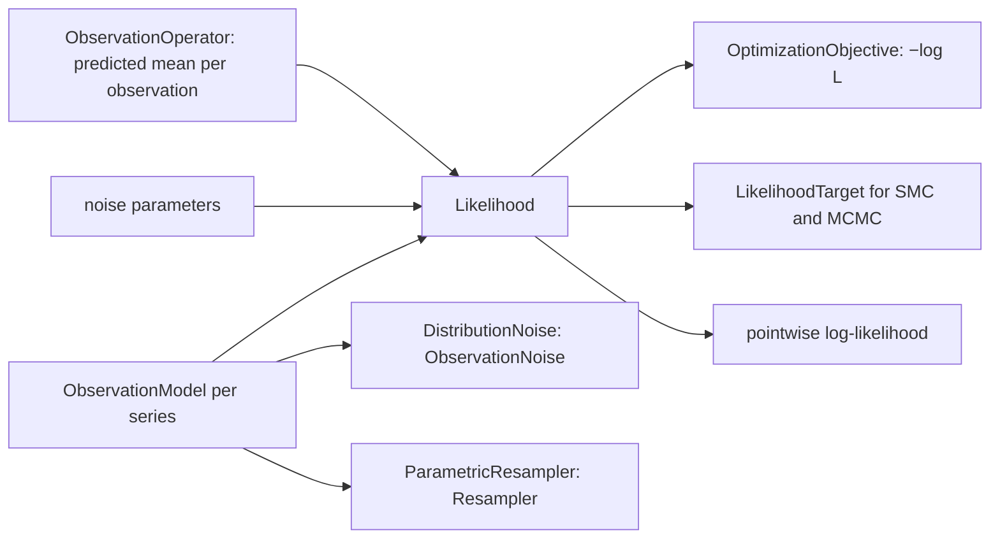

# Feature: observation models and the likelihood

Issue: [#131](https://github.com/MUNQU/commol/issues/131), which holds the status, the dependencies and the pull request.

Goal: let the user state how observations scatter around the model (a noise
distribution per series, with noise parameters that can be calibrated), and
get from it maximum-likelihood fits, Bayesian posteriors with evidence,
prediction intervals that include the noise, and the parametric bootstrap.
Motivation: the review found that no method can separate the uncertainty of
the parameters from the noise of the data without a noise model
(`inference-foundation.md` L1). The user wants methods that make this choice
next to methods that do not (L3).
Program: sixth of fourteen; follows the architecture of
`odd/inference-foundation.md`; adds a target to the core of
`odd/smc-inference.md` and a perturbation to
`odd/resampling-uncertainty.md`.
Branch: `feat/observation-models` from `develop`, after `smc-inference.md`
is merged.
Engram mirror: topic `odd/observation-models/tasks` (project `commol`).
Runners: the Rust tests, clippy and rustdoc (from the root), `maturin develop
--release --features test-kind`, then `pytest`, `pytest -m docs`, `ruff check
.`, `ty check commol` and `vulture` (from `py-commol/`), `mkdocs build
--strict` (from the root).

## Current state (verified 2026-10-15 on `develop` at `20a61a6`)

- The only discrepancy is `LossConfig` (`sse`, `rmse`, `mae`, with weights and
  normalization; `crates/commol-calibration/src/types.rs`). It has no
  distribution and no noise parameter.
- `CalibrationParameterType` has `parameter`, `initial_condition` and `factor`
  (`py-commol/commol/context/constants.py`, `calibration_problem.rs`).
- `ObservedDataPoint.value` is a float; nothing says whether it is a count.
- After the earlier ODDs: `ObservationNoise` port with `NoNoise` and
  `ResidualNoise`; `TemperedTarget`; `Perturbation::Values`; `Distribution`.

## Architecture

- `Likelihood` lives in `commol-calibration` next to `LossConfig`, as the
  second kind of discrepancy: one place for every log density of an
  observation. The optimizer, the targets, the predictive and the scores
  call it.
- The observation operator gives the predicted mean of each observed
  quantity (with sums, windows and factors); an observation model only adds
  how the observed value scatters around that mean.
- `DistributionNoise` implements `ObservationNoise`, and
  `ParametricResampler` implements `Resampler`, so the predictive and the
  bootstrap gain this ODD's models with no change.

## Specs

Every spec follows the [documentation definition of done](../docs/codebase/conventions.md#documentation-definition-of-done).

### S1 — Observation models

- Fix (D1, D4): `CalibrationProblem(observation_models={series: model})`,
  one model per series label: `Normal(sd)`, `LogNormal(sigma)`,
  `StudentT(df, scale)`, `Poisson()`, `NegativeBinomial(dispersion)`,
  `Binomial(trials)`. The mean of each is the predicted value; the other
  arguments are numbers or the ids of noise parameters.
- Fix (D2): a new `CalibrationParameterType.NOISE`, with bounds, for the
  parameters a model names; noise parameters never reach the engine.
- Fix (D5): discrete models require integer observed values and a
  non-negative predicted mean; `build` checks the values and says which
  observation fails.
- Check: a problem with a series that has no model, when another series has
  one, raises and names it; a noise parameter named by no model raises.

### S2 — The likelihood

- Fix: `Likelihood` in `commol-calibration/src/likelihood.rs`: log density
  of each model, written in commol; the observation weight is a power of its
  term (`w · log p`), so a weight keeps one meaning
  (`design-decisions.md`, "One meaning of an observation weight").
- Fix: `pointwise_log_likelihood(θ)` returns one value per observation, for
  `model-comparison.md`.
- Check: each log density equals stored reference values (computed once
  with SciPy and written in the test, because SciPy reaches the lock file
  only through `scikit-learn`, which `inference-foundation.md` S3 removes); a
  weight of 2 equals the observation written twice.

### S3 — Maximum likelihood

- Fix (D3): with `observation_models`, `OptimizationObjective` minimizes
  `−log L`, and `loss_function` must be absent; with no models,
  `loss_function` is required as today.
- Check: the MLE of the dispersion of negative-binomial data recovers the
  true value within its standard error; the MLE of `Normal(sd)` with
  identity model equals the least-squares fit.

### S4 — Bayesian posterior

- Fix: `LikelihoodTarget` implements `TemperedTarget` with
  `log_kernel(θ, λ) = λ · log L(θ)`; `BayesianPosterior(priors, particles, …)`
  runs it on the SMC core and returns `SmcResult` with the log evidence.
- Check: a conjugate model (a factor on a Normal series with known `sd`)
  gives its closed-form posterior and evidence.

### S5 — Prediction with noise

- Fix: `DistributionNoise` draws observed values from each model around each
  draw's predicted mean; `Predictive(…, noise=DistributionNoise())` gives
  prediction intervals; PIT values are randomized for discrete models.
- Fix: `commol.scores` gains the log score (the log predictive density of a
  held-out observation, from the mixture over draws).
- Check: posterior predictive intervals cover held-out data at the nominal
  level in a coverage study.

### S6 — Parametric bootstrap

- Fix: `ParametricBootstrap(replicates)` draws new data sets from the models
  at the fit and refits each through `ReplicateRunner`
  (`resampling-uncertainty.md`).
- Check: on a linear Normal model, the bootstrap variance equals the
  analytic one.

### S7 — Documentation

- Fix: `docs/guide/uncertainty/observation-models.md`: how to choose a model
  (counts, proportions, positive continuous values, outliers), what the noise
  parameters mean, MLE against posterior; rows in the table of
  `uncertainty/index.md`; `calibration.md` explains that a problem has either
  a loss or observation models.
- Check: `pytest -m docs`, `mkdocs build --strict`.

## Decisions (the user's to make)

Each row says why the recommendation beats each alternative.

| ID | Spec | Question | Recommendation | Why, against each alternative | Status |
|---|---|---|---|---|---|
| D1 | S1 | Where is a model declared? | On the problem, one per series label. | Per observation: the same model repeated on every point. On the model: noise is a property of how data were collected, not of the process; the same model is fitted to data of several kinds. | proposed |
| D2 | S1 | How are noise parameters calibrated? | A new parameter type `NOISE`. | Reuse `parameter`: the value writer would try to send it to the engine, and reports would mix it with model parameters. | proposed |
| D3 | S3 | Loss and observation models together? | Exclusive: one or the other. | Both, with the loss used by the optimizer and the likelihood by samplers: the fit and the posterior would answer different questions about the same problem. | proposed |
| D4 | S1 | Which models? | Normal, log-normal, Student-t, Poisson, negative binomial, binomial. | Fewer: no robust model (Student-t) and no overdispersed counts, the usual case. More (beta-binomial, zero-inflated): each is a small addition later, on the same code. | proposed |
| D5 | S1 | Non-integer observed values with a discrete model | Raise at `build`. | Round: changes the user's data silently. Accept: the log density of a non-integer count is not defined. | proposed |

## Tasks

| ID | Specs | Task | Route | Commit |
|---|---|---|---|---|
| T1 | S1 | Models, `NOISE` type, checks (Rust and Python) | direct | |
| T2 | S2 | `Likelihood`, pointwise log-likelihood | direct | |
| T3 | S3 | Objective `−log L`; exclusivity with the loss | direct | |
| T4 | S4 | `LikelihoodTarget`, `BayesianPosterior` | direct | |
| T5 | S5 | `DistributionNoise`, log score | direct | |
| T6 | S6 | `ParametricBootstrap` | direct | |
| T7 | S7 | Guide page, coverage studies, changelog | direct | |
| T8 | all | Final audit: every runner | direct | |

## Delivery

- Strategy: one PR to `develop`, squash-merged (`feat(calibration): …`).
- Order: T1 → T2 → T3 → T4 → T5 → T6 → T7 → T8.
- Version impact: added (a problem without observation models is unchanged).

## Evidence

(Filled during implementation.)

## Log

- L1 (user, 2026-10-15): see `inference-foundation.md` L1–L5; this ODD is
  the family of methods that state a noise model (L3).
