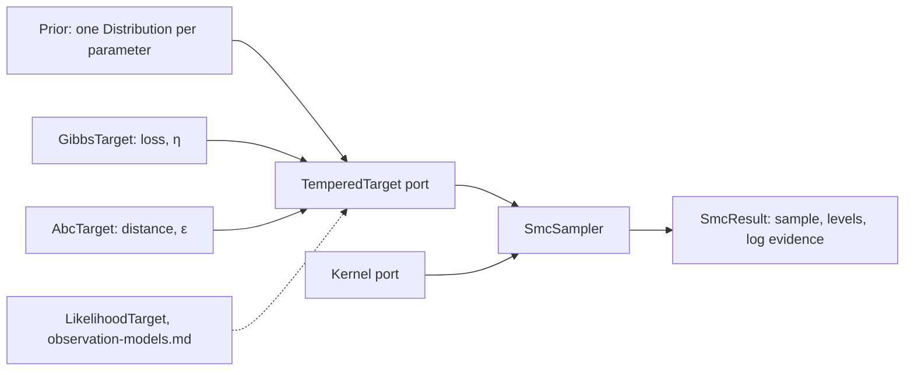

# Feature: sequential Monte Carlo, Gibbs posteriors and ABC

Issue: [#130](https://github.com/MUNQU/commol/issues/130), which holds the status, the dependencies and the pull request.

Goal: one sequential Monte Carlo (SMC) core that samples a sequence of
distributions, and two targets on it that need no noise model: the Gibbs
posterior of the user's loss, and approximate Bayesian computation (ABC-SMC)
on a distance. `observation-models.md` adds the likelihood target on the same
core.
Motivation: the user first thought of ABC-SMC (`inference-foundation.md` L2)
and wants methods with no noise model (L3). A Gibbs posterior turns the loss
commol already has into a posterior; ABC needs only a distance. One core
avoids three samplers that differ only in their target.
Program: fifth of fourteen; follows the architecture of
`odd/inference-foundation.md`; calibrates the Gibbs scale with
`odd/resampling-uncertainty.md` and `odd/identifiability.md`.
Branch: `feat/smc-inference` from `develop`, after
`conformal-prediction.md` is merged.
Engram mirror: topic `odd/smc-inference/tasks` (project `commol`).
Runners: the Rust tests, clippy and rustdoc (from the root), `maturin develop
--release --features test-kind`, then `pytest`, `pytest -m docs`, `ruff check
.`, `ty check commol` and `vulture` (from `py-commol/`), `mkdocs build
--strict` (from the root).

## Current state (verified 2026-10-15 on `develop` at `20a61a6`)

- No sampler exists. Parameters have bounds (`CalibrationParameter.min_bound`,
  `max_bound`) and no prior.
- After the earlier ODDs: `Target::log_density` (`−∞` outside the support),
  `ParameterSample` with weights and groups, the generator of
  `commol-random`, the stochastic engines and replicate seeds
  (`model-kind-foundation.md` S5–S7, `stochastic-compartmental.md`), the
  Bayesian bootstrap and `SensitivitySource`.

## Architecture

- `Distribution` (`commol-inference/src/distribution.rs`, Python
  `context/inference/distributions.py`) is the one family of distributions:
  priors here, inputs of `sensitivity-analysis.md`, noise parameters of
  `observation-models.md`. Each has `log_density`, `sample`, `cdf`,
  `quantile`, and is truncated to the parameter's bounds.
- `TemperedTarget` is a port: `log_prior(θ)` and `log_kernel(θ, level)`, where
  `level` runs from the prior (level 0) to the target (level 1 for a
  temperature, the final tolerance for ABC). The sampler never knows which
  target it runs.
- `Kernel` is a port for the moves that keep a distribution invariant. SMC
  uses it to move particles; `mcmc-samplers.md` reuses the same kernels for
  chains.
- `SmcSampler` owns the particles, the choice of the next level, resampling
  and the log evidence.

## Specs

Every spec follows the [documentation definition of done](../docs/codebase/conventions.md#documentation-definition-of-done).

### S1 — Distributions and priors

- Fix: `Uniform()` (on the bounds), `LogUniform()`, `Normal(mean, sd)`,
  `LogNormal(mu, sigma)`, `Beta(a, b)` (on the bounds), `Gamma(shape, rate)`,
  each truncated to the bounds; written in commol on the `commol-random`
  generator, so draws are the same on every platform
  (`model-kind-foundation.md` D6).
- Fix (D2): every sampling method takes `priors`, required: a mapping from
  parameter to `Distribution`, or `Priors.uniform_on_bounds()`, a classmethod
  that gives `Uniform()` to every parameter.
- Check: each distribution's moments, `cdf` and `quantile` equal closed forms;
  draws of a fixed seed equal a stored reference.

### S2 — The SMC core

- Fix (D1, D5, D6): `SmcSampler(particles, kernel, resample_threshold,
  target_cess)`: start from the prior; choose the next level by bisection so
  the conditional effective sample size (Zhou, Johansen and Aston 2016) equals
  `target_cess`; reweight; resample (systematic) when the effective sample
  size falls below `resample_threshold`; move every particle with the kernel,
  with as many steps as needed for the particles to decorrelate (stopping when
  the mean squared jump stabilizes); stop at level 1.
- Fix: the first kernel is random-walk Metropolis with the covariance of the
  particles scaled by `2.38² / d`. Moves run in parallel; each particle draws
  from its own stream of the generator.
- Fix: the log evidence, the product of the mean incremental weights, is
  kept for targets with a normalized kernel (`observation-models.md`).
- Check: on a Gaussian prior with a Gaussian kernel, the sample and the log
  evidence equal the closed forms within Monte Carlo error; two runs with one
  seed are equal.

### S3 — Gibbs posterior on the loss

- Fix: `GibbsPosterior(priors, eta, particles, …)` samples
  `π(θ) ∝ prior(θ) · exp(−η · loss(θ))`, where `loss` is the problem's loss
  (with weights and normalization), and returns `SmcResult`.
- Fix (D3): `eta` is required: a positive number, or a calibration object:
  `EtaCalibration.information_matching()` (Holmes and Walker 2017: matches the
  curvature of the loss, from `SensitivitySource`, to the variance of the
  loss terms) or `EtaCalibration.bootstrap_coverage(replicates)` (Syring and
  Martin 2019: adjusts `η` until the posterior intervals cover the fit of
  Bayesian-bootstrap data sets at the nominal level). The result reports the
  `η` used.
- Check: with the sum of squares of a linear model with Gaussian noise of
  variance `σ²`, `η = 1/(2σ²)` gives the exact posterior; information matching
  gives that `η` within its error; coverage study for both calibrations.

### S4 — ABC-SMC

- Fix (D4): `AbcSmc(priors, distance, particles, quantile, min_acceptance)`:
  the level is a tolerance `ε`; the kernel accepts `θ` when
  `distance(simulated, observed) ≤ ε`; each next `ε` is the `quantile` of the
  current distances (Del Moral, Doucet and Jasra 2012); it stops when the
  acceptance rate of the moves falls below `min_acceptance`.
- Fix: `distance` is required: `LossDistance()` (the problem's loss on the
  observed quantities, normalization and weights included) or
  `SeriesDistance(metric)` (a distance per series, combined by the maximum).
- Fix: with a stochastic engine, each distance evaluation runs one fresh
  replicate, seeded from the particle's stream; with a deterministic engine,
  ABC samples an approximate posterior around the loss.
- Fix: `AbcRejection(priors, distance, draws, quantile)` is the one-step case
  (draw from the prior, keep the closest), on the same code.
- Check: on a model with a closed-form posterior, the ABC sample approaches
  it as `ε` falls; with the stochastic test engine, the sample covers the true
  parameter in a coverage study; two runs with one seed are equal.

### S5 — Results and documentation

- Fix: `SmcResult(sample, levels, log_evidence, diagnostics)`: the levels or
  tolerances, the effective sizes, acceptance rates and move counts per
  step.
- Fix: `docs/guide/uncertainty/smc.md`: the Gibbs posterior and what `η`
  means, ABC and its distance, how to read the diagnostics; rows in the table
  of `uncertainty/index.md`; `design-decisions.md` gets "One SMC core, many
  targets".
- Check: `pytest -m docs`, `mkdocs build --strict`.

## Decisions (the user's to make)

Each row says why the recommendation beats each alternative.

| ID | Spec | Question | Recommendation | Why, against each alternative | Status |
|---|---|---|---|---|---|
| D1 | S2 | One SMC core or one sampler per method? | One core with a `TemperedTarget` port. | ABC-SMC as population Monte Carlo (Toni et al. 2009) plus a separate tempering sampler: two codes for resampling, moves and diagnostics, which drift apart. | proposed |
| D2 | S1 | Where are priors given? | A required `priors` argument of each sampling method, with `Priors.uniform_on_bounds()`. | On `CalibrationParameter`: optimizers would carry a field they ignore. An implicit uniform: a modelling choice made silently; the user asked to avoid hidden assumptions (`inference-foundation.md` L3). | proposed |
| D3 | S3 | How is `η` set? | Required: a number or one of two calibrations, information matching or bootstrap coverage. | `η = 1` by default: arbitrary, since the loss has no scale; the posterior can be far too narrow or wide. One calibration only: information matching is cheap but local; bootstrap coverage is robust but costs many runs; the user picks by budget. | proposed |
| D4 | S4 | What distance does ABC use? | Required: the problem's loss, or a distance per series. | User summary statistics (peak, final size): useful, but a typed language of summaries is a larger piece; the quantities of interest of `sensitivity-analysis.md` can feed it later. | proposed |
| D5 | S2 | How is the next level chosen? | Bisection on the conditional effective sample size. | A fixed schedule of temperatures: too fast loses particles, too slow wastes runs; it needs tuning per model. | proposed |
| D6 | S2 | First move kernel | Random-walk Metropolis with the particles' covariance. | Independent proposals from a fitted mixture: fail when the posterior has a curved ridge. Slice sampling: no tuning, but more model runs per move. Both can be added as kernels. | proposed |

## Tasks

| ID | Specs | Task | Route | Commit |
|---|---|---|---|---|
| T1 | S1 | `Distribution`, `Priors` | direct | |
| T2 | S2 | `TemperedTarget`, `Kernel`, `SmcSampler`, random-walk kernel | direct | |
| T3 | S3 | `GibbsTarget`, `η` calibrations | direct | |
| T4 | S4 | `AbcTarget`, ABC-SMC, ABC rejection; stochastic engines | direct | |
| T5 | S5 | Results, guide page, coverage studies | direct | |
| T6 | all | Final audit: every runner | direct | |

## Delivery

- Strategy: one PR to `develop`, squash-merged (`feat(inference): …`).
- Order: T1 → T2 → T3 → T4 → T5 → T6.
- Version impact: added.

## Evidence

(Filled during implementation.)

## Log

- L1 (user, 2026-10-15): see `inference-foundation.md` L1–L5; ABC-SMC was
  the user's first idea (L2); the Gibbs posterior answers L3.
