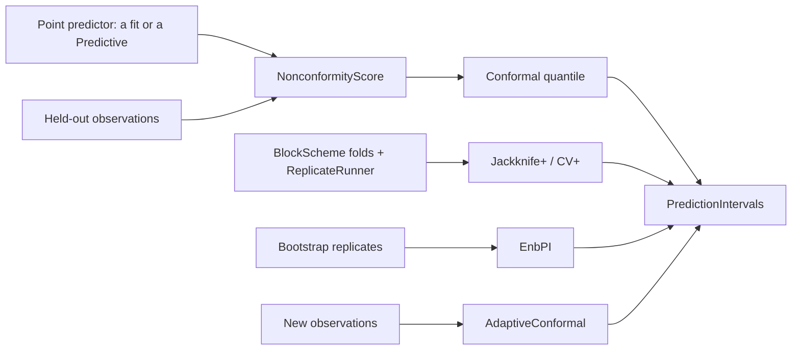

# Feature: conformal prediction intervals

Goal: prediction intervals with a coverage guarantee that needs no noise
model, no prior and no correct model, around a fit or any parameter sample.
Motivation: the user wants methods with no a priori choice of the source of
uncertainty (`inference-foundation.md` L3). Conformal prediction is the only
family whose guarantee holds even when the model is wrong; it answers "will
the next observations fall inside?", not "which parameters fit?".
Program: fourth of fourteen; follows the architecture of
`odd/tasks/inference-foundation.md`; uses the blocks and replicates of
`odd/tasks/resampling-uncertainty.md`.
Branch: `feat/conformal-prediction` from `develop`, after
`resampling-uncertainty.md` is merged.
Engram mirror: topic `odd/conformal-prediction/tasks` (project `commol`).
Runners: the Rust tests, clippy and rustdoc (from the root), `maturin develop
--release --features test-kind`, then `pytest`, `pytest -m docs`, `ruff check
.`, `ty check commol` and `vulture` (from `py-commol/`), `mkdocs build
--strict` (from the root).

## Current state (verified 2026-10-15 on `develop` at `20a61a6`)

- No code computes prediction intervals from held-out errors. The ensemble
  measured coverage on the data it was fitted to
  (`inference-foundation.md`, "Current state").
- After the earlier ODDs: `Predictive.at_observations` gives every draw's
  value of each observation; `BlockScheme`, `ReplicateRunner` and the
  bootstrap replicates exist; `commol.scores` measures coverage.

## Architecture

- A `NonconformityScore` turns a predicted and an observed value into a
  score; each variant below only chooses which predictions and which held-out
  values feed it. The score and the quantile live once, in
  `commol-inference/src/conformal/`.
- `PredictionIntervals` (positions × outputs, lower, upper, level, the
  guarantee in words) is the result of every variant. The plotter and the
  reports accept it.

## Specs

Every spec follows the [documentation definition of done](../../docs/codebase/conventions.md#documentation-definition-of-done).

### S1 — Scores

- Fix (D1): `score` is required: `"absolute"` (`|y − ŷ|`), `"normalized"`
  (`|y − ŷ| / s`, where `s` is the normalization factor of the series), or
  `"spread"` (`|y − ŷ| / σ̂`, where `σ̂` is the spread of a `Predictive` at that
  point: locally adaptive intervals).
- Fix (D2): quantiles are taken per series (`by="series"`) or over all series
  (`by="all"`), required; per series needs enough held-out points and says so
  when it has fewer than `1/α − 1`.
- Check: the conformal quantile of `n` scores is the
  `⌈(n + 1)(1 − α)⌉`-th smallest; `"spread"` gives wider intervals where the
  predictive is wider.

### S2 — Split conformal

- Fix: `SplitConformal(calibration_data, score, by)` fits on the problem's
  observations and scores `calibration_data` (later positions, held out by
  the user). The guarantee: coverage at least `1 − α` when the scores are
  exchangeable.
- Fix (D3): for intervals ahead of the data, `horizons=True` scores each
  calibration point by its distance from the last fitted position, with
  rolling origins (one refit per origin, through `ReplicateRunner`), so each
  horizon gets its own quantile.
- Check: on exchangeable synthetic data, coverage at least `1 − α` over many
  data sets (`coverage_study`); with `horizons=True`, intervals widen with the
  horizon on a random-walk test series.

### S3 — Jackknife+ and CV+

- Fix: `JackknifePlus(block_length, score)` refits with each block left out
  (`BlockScheme`, `ReplicateRunner`) and builds intervals from the left-out
  residuals and the left-out predictions (Barber et al. 2021). `CVPlus(folds)`
  does the same with `folds` contiguous folds of blocks. Guarantee:
  coverage at least `1 − 2α` under exchangeability, with no held-out set.
- Check: coverage study for both.

### S4 — EnbPI

- Fix: `EnbPI(bootstrap)` takes a `BootstrapResult` of
  `resampling-uncertainty.md` and builds the leave-one-out aggregate of the
  replicates that left each block out (Xu and Xie 2021): intervals for time
  series with no extra fits. Guarantee: approximate, under stationary and
  strongly mixing errors.
- Check: coverage study with AR(1) noise.

### S5 — Adaptive conformal inference

- Fix: `AdaptiveConformal(level, step)` is a stateful object: each `update`
  with a new observation moves the working level by
  `α_{t+1} = α_t + γ (α − err_t)` (Gibbs and Candès 2021) and gives the next
  interval. Guarantee: the long-run share of misses tends to `α`, with no
  assumption on the data.
- Check: on a series with a change of regime, the running miss rate returns
  to `α`, while split conformal does not.

### S6 — Results and documentation

- Fix: `ConformalResult(intervals, scores, guarantee)`; each variant states
  its guarantee in the result and the guide.
- Fix: `docs/guide/uncertainty/conformal.md`: what the guarantee means and
  when it holds, which variant fits forecasting, how to hold data out; rows in
  the table of `uncertainty/index.md`.
- Check: `pytest -m docs`, `mkdocs build --strict`.

## Decisions (the user's to make)

Each row says why the recommendation beats each alternative.

| ID | Spec | Question | Recommendation | Why, against each alternative | Status |
|---|---|---|---|---|---|
| D1 | S1 | Which score by default? | None: `score` is required. | `"absolute"` by default: series of different size get one quantile scale; `"normalized"` by default: hides that `"spread"` gives adaptive intervals. The choice changes the width pattern, a modelling choice. | proposed |
| D2 | S1 | Quantile per series or pooled? | Required `by`; per series is the guide's first example. | Pooled always: a small series borrows the errors of a large one. Per series always: few held-out points per series give infinite intervals. | proposed |
| D3 | S2 | Intervals ahead of the data | Rolling origins, one quantile per horizon, behind `horizons=True`. | One split: the errors one step ahead set the width of every horizon, so far horizons undercover. Always rolling: costs one fit per origin when the user predicts nothing ahead. | proposed |
| D4 | S2–S5 | Which variants? | Split, jackknife+ and CV+, EnbPI, adaptive. | Split only: needs held-out data, so short series lose; no time-series guarantee. Conformalized quantile regression: needs a quantile model, which a mechanistic model is not. | proposed |

## Tasks

| ID | Specs | Task | Route | Commit |
|---|---|---|---|---|
| T1 | S1 | Scores, conformal quantile, `PredictionIntervals` | direct | |
| T2 | S2 | Split conformal, horizons | direct | |
| T3 | S3 | Jackknife+, CV+ | direct | |
| T4 | S4 | EnbPI | direct | |
| T5 | S5 | Adaptive conformal | direct | |
| T6 | S6 | Plotter and reports; guide page; coverage studies | direct | |
| T7 | all | Final audit: every runner | direct | |

## Delivery

- Strategy: one PR to `develop`, squash-merged (`feat(inference): …`).
- Order: T1 → T2 → T3 → T4 → T5 → T6 → T7.
- Version impact: added.

## Evidence

(Filled during implementation.)

## Log

- L1 (user, 2026-10-15): see `inference-foundation.md` L1–L5; this ODD
  answers L3 for predictions.
