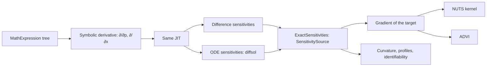

# Feature: exact derivatives and gradient-based inference

Goal: exact derivatives of every output with respect to every calibrated
value, in both deterministic engines, and the methods they enable: exact
sensitivities and Fisher information, the No-U-Turn sampler (NUTS) and
automatic differentiation variational inference (ADVI).
Motivation: gradient-free samplers slow down as the number of parameters
grows; gradients make posteriors of stratified models with many parameters
practical. The user wants as many methods as possible
(`inference-foundation.md` L2).
Program: tenth of fourteen; follows the architecture of
`odd/tasks/inference-foundation.md`; adds an implementation behind
`SensitivitySource` (`odd/tasks/identifiability.md`) and runs on the chains of
`odd/tasks/mcmc-samplers.md`.
Branch: `feat/gradient-inference` from `develop`, after `mcmc-samplers.md`
is merged.
Engram mirror: topic `odd/gradient-inference/tasks` (project `commol`).
Runners: the Rust tests, clippy and rustdoc (from the root), `maturin develop
--release --features test-kind`, then `pytest`, `pytest -m docs`, `ruff check
.`, `ty check commol` and `vulture` (from `py-commol/`), `mkdocs build
--strict` (from the root).

## Current state (verified 2026-10-15 on `develop` at `20a61a6`)

- `crates/commol-core/src/math_expression/` parses rate expressions into a
  tree and compiles them to machine code (`jit/codegen.rs`); it has no
  differentiation.
- Formula parameters are evaluated every step, in order
  (`docs/codebase/design-decisions.md`, "Formula parameters are evaluated
  every step, in order"); a derivative must follow that chain.
- `diffsol` 0.17.1 solves forward sensitivity equations
  (`src/ode_equations/sens_equations.rs`) when the problem supplies the
  derivative of the right-hand side with respect to the parameters;
  `commol-differential` builds its problem with `OdeBuilder` and closures that
  supply none (`crates/commol-differential/src/solve.rs:154`).
- A difference step that would leave an amount below zero stops the run
  (`design-decisions.md`, "A difference step never leaves an amount below
  zero"), so inside the feasible region the step is differentiable.
- After the earlier ODDs: `SensitivitySource` with finite differences,
  `Curvature`, `ChainRunner`, diagnostics, PSIS.

## Architecture

- Derivatives of expressions are new expressions, compiled by the JIT that
  compiles rates, so they run at the same speed and stay exact.
- Each engine propagates sensitivities with its own scheme; both answer
  through `SensitivitySource`, so the identifiability, curvature and profile
  code of earlier ODDs gets exact derivatives with no change.
- NUTS is a `Kernel` on the `ChainRunner`; ADVI is a method of its own that
  returns a `ParameterSample` checked by PSIS.

## Specs

Every spec follows the [documentation definition of done](../../docs/codebase/conventions.md#documentation-definition-of-done).

### S1 — Derivatives of expressions

- Fix (D1): `MathExpression::derivative(variable)` returns the derivative
  tree, simplified (constant folding, zero and one terms), for every function
  of `docs/guide/mathematical-expressions.md`. `min`, `max`, `abs` and
  conditionals give their one-sided derivative and are listed as
  non-differentiable at their switching points.
- Fix (D4): derivatives through formula parameters follow their order (chain
  rule over the formula definitions).
- Check: every function's derivative equals a central difference at random
  points within its error; the derivative of a formula parameter that reads
  another equals the hand-written chain.

### S2 — Sensitivities in the difference engine

- Fix: the difference engine propagates the sensitivity matrix with its own
  step, `S_{t+1} = S_t + Δt (∂f/∂x · S_t + ∂f/∂p)`, impulses included, and
  returns it at the requested positions.
- Check: equal to finite differences on the reference models within their
  error, and exact (to rounding) for a linear model.

### S3 — Sensitivities in the ODE engine

- Fix: `commol-differential` supplies the compiled `∂f/∂p` to `diffsol`'s
  forward sensitivity equations; initial conditions that are calibrated give
  the initial sensitivities. The `diffsol` version stays pinned
  (`~0.17.1`), and a version change re-checks this API.
- Check: equal to finite differences on the reference models within the
  solver tolerance.

### S4 — Exact sensitivities and gradients

- Fix: `ExactSensitivities` implements `SensitivitySource` by chaining the
  engine's sensitivities through `ObservationOperator` (sums, windows,
  factors) and the initial-condition writer. `gradient(θ)` of a loss or a
  log-likelihood follows from it.
- Fix: methods take `sensitivities="exact" | "finite_differences"`; with an
  engine that has no exact sensitivities, `"exact"` raises and names the
  engine.
- Check: the identifiability and Laplace tests of earlier ODDs pass with
  `"exact"`.

### S5 — NUTS

- Fix (D2): `Nuts` kernel, the multinomial variant of Stan (Hoffman and
  Gelman 2014; Betancourt 2017), with dual-averaging step size and diagonal
  or dense mass matrix adapted in Stan's warmup windows; divergences and tree
  depth reported in the diagnostics.
- Check: on correlated Gaussian and banana targets, moments within Monte
  Carlo error and fewer target evaluations per effective draw than adaptive
  Metropolis; coverage study.

### S6 — ADVI

- Fix (D3): `Advi(family="meanfield" | "fullrank", draws)` (Kucukelbir et al.
  2017): a Gaussian on the unconstrained scale fitted by stochastic gradient
  ascent on the evidence lower bound; the result is a `ParameterSample` of
  draws with PSIS weights against the target and its `k̂` (Yao et al. 2018), so
  a poor approximation is reported, not hidden.
- Check: on a Gaussian target, full-rank ADVI recovers the covariance;
  mean-field reports a high `k̂` on a correlated target.

### S7 — Documentation

- Fix: `docs/guide/uncertainty/gradients.md`: which engines give exact
  derivatives, non-differentiable functions, NUTS diagnostics, when ADVI is
  enough; rows in the table of `uncertainty/index.md`;
  `docs/codebase/design-decisions.md` gets "Derivatives are compiled
  expressions".
- Check: `pytest -m docs`, `mkdocs build --strict`.

## Decisions (the user's to make)

Each row says why the recommendation beats each alternative.

| ID | Spec | Question | Recommendation | Why, against each alternative | Status |
|---|---|---|---|---|---|
| D1 | S1 | How are derivatives made? | Symbolic derivatives of the expression tree, compiled by the same JIT. | Dual numbers through the JIT: a second code generator for a new number type. Finite differences only: inexact, and `p + 1` runs per gradient, which defeats NUTS. An external autodiff crate: would need the model rewritten in its types. | proposed |
| D2 | S5 | Which NUTS? | Stan's multinomial variant with its warmup. | The original slice variant: less efficient and less tested in practice. Plain Hamiltonian Monte Carlo: needs a path length tuned per model. | proposed |
| D3 | S6 | ADVI in scope? | Yes, always with its PSIS `k̂`. | Out: loses a fast approximation for large models. In without `k̂`: a narrow wrong posterior with no warning. | proposed |
| D4 | S1 | Formula and series parameters | Differentiate through formulas by their order; series parameters are data and have no derivative. | Exclude models with formulas: many models use them. | proposed |

## Tasks

| ID | Specs | Task | Route | Commit |
|---|---|---|---|---|
| T1 | S1 | Symbolic derivatives, simplification, JIT | direct | |
| T2 | S2 | Difference-engine sensitivities | direct | |
| T3 | S3 | ODE-engine sensitivities through `diffsol` | direct | |
| T4 | S4 | `ExactSensitivities`, gradients, the `sensitivities` option | direct | |
| T5 | S5 | NUTS | direct | |
| T6 | S6 | ADVI | direct | |
| T7 | S7 | Guide page, design decision, coverage studies | direct | |
| T8 | all | Final audit: every runner | direct | |

## Delivery

- Strategy: one PR to `develop`, squash-merged (`feat(inference): …`). If T3
  shows that `diffsol`'s sensitivity API needs a version change, T1–T2 and
  T4–T7 merge first and T3 gets its own PR.
- Order: T1 → T2 → T3 → T4 → T5 → T6 → T7 → T8.
- Version impact: added.

## Evidence

(Filled during implementation.)

## Log

- L1 (user, 2026-10-15): see `inference-foundation.md` L1–L5.
