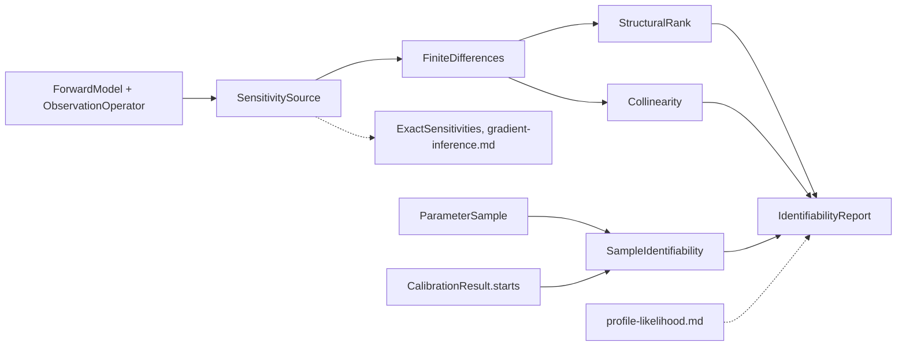

# Feature: identifiability of parameters

Goal: tell the user, before and after a fit, which parameters the model and
the data determine, which they do not, and which combination of parameters
the data determine in their place.
Motivation: the user added identifiability to the uncertainty study
(`inference-foundation.md` L4). Today a parameter the data cannot determine
only shows up as a wide interval, with no reason given.
Program: second of fourteen; follows the architecture of
`odd/tasks/inference-foundation.md`.
Branch: `feat/identifiability` from `develop`, after
`inference-foundation.md` is merged.
Engram mirror: topic `odd/identifiability/tasks` (project `commol`).
Runners: the Rust tests, clippy and rustdoc (from the root), `maturin develop
--release --features test-kind`, then `pytest`, `pytest -m docs`, `ruff check
.`, `ty check commol` and `vulture` (from `py-commol/`), `mkdocs build
--strict` (from the root).

## Current state (verified 2026-10-15 on `develop` at `20a61a6`)

- No code checks identifiability. The only mention is a warning in
  `docs/guide/calibration-observations.md:155`: "A rate and a share can
  explain the same data. Fit them together only when the data can tell them
  apart."
- No code computes derivatives of the model with respect to its parameters.
  `crates/commol-core/src/math_expression/` compiles expressions to machine
  code and has no differentiation.
- `diffsol` 0.17.1 has forward sensitivity equations
  (`src/ode_equations/sens_equations.rs`), but `commol-differential` builds its
  problem from closures with no parameter derivatives
  (`crates/commol-differential/src/solve.rs:154`). `gradient-inference.md` adds
  them.
- After `inference-foundation.md`: `ForwardModel::run_observed` gives one
  predicted value per observation; `Calibrator.run(starts=n)` reports every
  start; `ParameterSample` carries weighted draws; `nalgebra` is available.

## Architecture

- `SensitivitySource` is a port in `commol-inference/src/sensitivity/`: it
  returns the Jacobian of the predicted observations with respect to the
  parameters. Every user of derivatives (this ODD, `local-approximations.md`,
  `profile-likelihood.md`, `gradient-inference.md`) asks the port; only the
  port knows how the derivatives are made.
- `IdentifiabilityReport` is one result with optional sections, so each
  method adds its evidence to the same verdict per parameter, and
  `profile-likelihood.md` adds a section with no change here.
- Identifiability gets its own entry point, `Calibrator.identifiability(method)`,
  built like `Calibrator.uncertainty` (generic, with a registry; D6).

## Specs

Every spec follows the [documentation definition of done](../../docs/codebase/conventions.md#documentation-definition-of-done).

### S1 — Sensitivities

- Fix: `SensitivitySource::jacobian(θ) -> Matrix` (`n_observations ×
  n_parameters`) and `FiniteDifferences`, its first implementation: central
  differences with the step `h_j = ε^{1/3} · max(|θ_j|, w_j)`, where `w_j` is
  the width of the bounds; one-sided near a bound; the columns in parallel.
  Each column states its estimated truncation error.
- Fix (D2): the scaled Jacobian, used by S2 and S3, is
  `S_ij = (∂y_i/∂θ_j) · θ_j / s_i`: the change of observation `i`, relative to
  its scale `s_i`, for a relative change of parameter `j`. `s_i` is the
  normalization factor of its series when the problem normalizes, and the
  root mean square of the series otherwise.
- Check: the Jacobian of an exponential decay equals its closed form within
  the stated error; a parameter the outputs do not read gives a zero column.

### S2 — Structural identifiability, local and numerical

- Fix (D1, D3): `StructuralRank(points, design, seed)` evaluates the scaled
  Jacobian on a noise-free design at `points` Latin-hypercube points inside
  the bounds. `design="observations"` uses the positions and outputs of the
  problem's observations, with their values ignored; `design="dense"` uses
  every state output at every unit position up to the last observation. The
  first answers "can this design determine the parameters?", the second "can
  any data from this model?".
- Fix (D4): the numerical rank at each point counts the singular values above
  a threshold set from the finite-difference error of S1. The generic rank is
  the rank at most points; the report gives every point's singular values.
- Fix: each right singular vector of the null space is reported as a
  combination of log-parameters with rounded exponents. A null vector
  `(1, 1, 0)` over `(k1, f, k2)` reads "only `k1 · f` is identifiable".
- Fix: the verdict per parameter is `identifiable`, `non_identifiable` (its
  column lies in the null space alone) or `in_combination` (with the
  combination).
- Check: a model where a rate and a factor enter only as a product reports
  `in_combination` with `k · f`; the SIR model of `tests/reference_models/`
  observed in every compartment is identifiable; the same model observed only
  in one compartment at three positions reports a smaller rank for
  `"observations"` than for `"dense"`.

### S3 — Collinearity analysis

- Fix: `Collinearity(at, max_subset_size, threshold)` computes, after Brun et
  al. (2001), the sensitivity measure `δ_msqr` of each parameter and the
  collinearity index `γ_K` of each subset up to `max_subset_size` (all
  subsets up to 6 parameters; a greedy search above). `at` is a
  `CalibrationResult` or a `ParameterSample` (the indices are computed at each
  draw and summarized). The largest subsets with `γ_K` below `threshold` are
  the parameters that can be fitted together.
- Fix (D5): `threshold` has no default; the guide gives the range of the
  literature (5 to 20) and what it means.
- Check: two parameters with proportional columns give an infinite index; an
  orthogonal design gives `γ = 1`.

### S4 — Practical identifiability from a sample

- Fix: `SampleIdentifiability(sample, reference)` reads any
  `ParameterSample`: the contraction of each parameter, `1 − Var(sample) /
  Var(reference)`, where `reference` is the uniform distribution on the bounds
  or, once `smc-inference.md` adds them, the prior; the correlation matrix and
  the pairs above a threshold; a flag when a marginal has several modes
  (two or more separated peaks of a kernel density estimate).
- Fix: `StartsIdentifiability(result)` reads `CalibrationResult.starts`: ends
  that differ in parameters by more than a tolerance with losses within a
  tolerance flag the parameters that differ.
- Check: a sample with one parameter spread over its bounds reports a
  contraction near zero; two parameters on a ridge report a correlation near
  ±1.

### S5 — One report

- Fix: `IdentifiabilityReport` holds one verdict per parameter and the
  sections `structural`, `collinearity`, `sample`, `starts` (and `profile`,
  from `profile-likelihood.md`), each optional, each with its evidence.
  `IdentifiabilityReport.merge` joins reports from several methods; a verdict
  that sections disagree on is `conflicting`, with both reasons.
- Fix: `api/reporting.py` gets `identifiability_report(report)`, a data block
  as the other reports (`design-decisions.md`, "Reports").
- Check: merging a structural `in_combination` with a sample contraction near
  zero keeps `in_combination`; merging `identifiable` with
  `non_identifiable` gives `conflicting`.

### S6 — Entry point and documentation

- Fix (D6): `Calibrator.identifiability(method: IdentifiabilityMethod[R]) -> R`,
  with the registry pattern of `inference-foundation.md` S8.
- Fix: `docs/guide/uncertainty/identifiability.md`: structural against
  practical, what each method needs and answers, how to read a combination,
  the limits (local, numerical, generic points). The warning of
  `calibration-observations.md:155` points to it. A row per method in the
  table of `uncertainty/index.md`. `design-decisions.md` gets "Sensitivities
  come from one port".
- Check: `pytest -m docs`, `mkdocs build --strict`.

## Decisions (the user's to make)

Each row says why the recommendation beats each alternative.

| ID | Spec | Question | Recommendation | Why, against each alternative | Status |
|---|---|---|---|---|---|
| D1 | S1, S2 | Where do derivatives come from in this ODD? | Finite differences behind `SensitivitySource`; `gradient-inference.md` adds exact ones behind the same port. | Exact derivatives first: they need symbolic differentiation of expressions and sensitivity equations in two engines, a large ODD on its own, and would delay every user of the port. Automatic differentiation through the JIT: the JIT emits machine code, so dual numbers would need a second code generator. | proposed |
| D2 | S1 | How is the Jacobian scaled? | Relative to the parameter value and to the scale of each series. | Raw derivatives: the rank depends on units, so a rate per day and one per week give different answers. Relative to the parameter only: series of different size weigh differently. | proposed |
| D3 | S2 | Which structural method? | Numerical rank of the sensitivity matrix at random points, on two designs. | Symbolic methods (DAISY, SIAN, StructuralIdentifiability.jl): global and exact, but they need Julia or Maple, cover differential equations only, and do not see windows, sums or factors. A later ODD can export a model to them. Rank at the fitted point only: a special point can lose or gain rank. | proposed |
| D4 | S2 | How is the rank threshold set? | From the estimated finite-difference error, and the singular values are reported. | A fixed `1e-10`: below the error of finite differences, so every model looks identifiable. A user setting: the user cannot know the error. | proposed |
| D5 | S3 | Default collinearity threshold? | None: a required argument, with the literature range in the guide. | 15 by default: a modelling judgment hidden in the library; modelling choices are the user's, with no library default (`model-kind-foundation.md` L9). | proposed |
| D6 | S6 | Entry point | `Calibrator.identifiability(method)`, apart from `uncertainty`. | Under `uncertainty`: a different question; mixing them makes the table of the guide harder to read. Free functions: repeat the simulation and problem arguments. | proposed |

## Out of scope

- Symbolic, global structural identifiability (see D3).
- Experimental design: which observations would make a parameter identifiable.
  It reads the same report and gets its own ODD.

## Tasks

| ID | Specs | Task | Route | Commit |
|---|---|---|---|---|
| T1 | S1 | `SensitivitySource`, `FiniteDifferences`, scaling | direct | |
| T2 | S2 | `StructuralRank`: designs, ranks, null-space combinations | direct | |
| T3 | S3 | `Collinearity` | direct | |
| T4 | S4 | `SampleIdentifiability`, `StartsIdentifiability` | direct | |
| T5 | S5, S6 | `IdentifiabilityReport`, merge, report block; entry point | direct | |
| T6 | S6 | Guide page, design decision, changelog | direct | |
| T7 | all | Final audit: every runner | direct | |

## Delivery

- Strategy: one PR to `develop`, squash-merged (`feat(identifiability): …`).
- Order: T1 → T2 → T3 → T4 → T5 → T6 → T7.
- Version impact: added.

## Evidence

(Filled during implementation.)

## Log

- L1 (user, 2026-10-15): see `inference-foundation.md` L1–L5; identifiability
  was added by L4.
