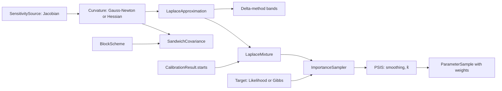

# Feature: local approximations and importance sampling

Goal: fast uncertainty around a fit (Fisher information, Laplace
approximation, delta method, and a sandwich covariance that holds when the
model or the noise is wrong), and the repaired ensemble: a mixture of Laplace
approximations at the optima of a multi-start fit, corrected by Pareto-smoothed
importance sampling.
Motivation: the user asked whether the ensemble can be repaired
(`inference-foundation.md` L2). This is the repair that keeps its idea (many
optima from many starts) and gives it a meaning (a posterior, with a check of
when the approximation fails). The sandwich covariance needs no noise model
(L3).
Program: eighth of fourteen; follows the architecture of
`odd/tasks/inference-foundation.md`; reads `SensitivitySource`
(`odd/tasks/identifiability.md`), the blocks of
`odd/tasks/resampling-uncertainty.md` and the likelihood of
`odd/tasks/observation-models.md`.
Branch: `feat/local-approximations` from `develop`, after
`profile-likelihood.md` is merged.
Engram mirror: topic `odd/local-approximations/tasks` (project `commol`).
Runners: the Rust tests, clippy and rustdoc (from the root), `maturin develop
--release --features test-kind`, then `pytest`, `pytest -m docs`, `ruff check
.`, `ty check commol` and `vulture` (from `py-commol/`), `mkdocs build
--strict` (from the root).

## Current state (verified 2026-10-15 on `develop` at `20a61a6`)

- No code computes a Hessian, a covariance of the fit or an importance
  weight.
- After the earlier ODDs: `SensitivitySource` (finite differences),
  `Calibrator.run(starts=n)` with every start's end, `BlockScheme`,
  `Likelihood` with pointwise values, `GibbsTarget`, `Predictive`, `nalgebra`.

## Architecture

- `Curvature` turns derivatives into a matrix on the unconstrained scale (a
  logit of each bounded parameter); every approximation below reads it.
- `ImportanceSampler` takes any proposal and any `Target`; PSIS is a separate
  function that `gradient-inference.md` (ADVI) and `model-comparison.md`
  (PSIS-LOO) reuse.

## Specs

Every spec follows the [documentation definition of done](../../docs/codebase/conventions.md#documentation-definition-of-done).

### S1 — Curvature

- Fix (D1): Gauss-Newton by default, `JᵀWJ` from `SensitivitySource` (with
  the Fisher information of each observation model, or the loss weights);
  `curvature="hessian"` takes finite differences of the objective, needed when
  the fit sits on a constraint or the residuals are large.
- Fix (D2): matrices live on the unconstrained scale; results map back with
  the Jacobian of the transform.
- Check: on a linear Normal model both equal the analytic information.

### S2 — Laplace approximation and delta method

- Fix: `Laplace(draws)` gives the Gaussian `N(θ̂, Σ)` on the unconstrained
  scale, with `Σ` the inverse curvature; returns `LaplaceResult(fit,
  covariance, sample)`, where `sample` holds `draws` draws mapped back.
- Fix: `LaplaceResult.delta_band(positions, level)` is the linearized band of
  predictions, `J_pred Σ J_predᵀ`, with no simulation of draws.
- Check: coverage study on a model where the posterior is near Gaussian.

### S3 — Sandwich covariance

- Fix (D4): `Sandwich(block_length)`: `H⁻¹ B H⁻¹`, where `H` is the curvature
  and `B` the sum over blocks of the outer products of the block gradients of
  the loss (a block version of the Newey–West estimator), so it holds under
  dependence, non-constant noise and a wrong noise model. Needs only the loss.
- Check: with independent Gaussian noise of known variance it equals the
  Laplace covariance within error; with non-constant noise its coverage holds
  where Laplace's does not.

### S4 — Laplace mixture and importance sampling

- Fix: `LaplaceMixture(starts, draws, target)`: runs `starts` starts, keeps the
  distinct optima (merged when closer than one Mahalanobis unit), fits a
  Laplace component at each, weights components by their Laplace evidence,
  draws from the mixture, and weights each draw by `target / mixture`.
- Fix (D3): Pareto-smoothed importance sampling (Vehtari et al. 2024)
  smooths the largest weights; the result reports `k̂` and the effective size.
  `k̂ > 0.7` marks the sample as unreliable in the result and the log.
- Fix: the target is `LikelihoodTarget` with priors, or `GibbsTarget` with
  `η` (`smc-inference.md`).
- Check: a two-mode target gives both modes in proportion; a banana-shaped
  target gives `k̂ > 0.7`; coverage study on a two-optimum model.

### S5 — Results and documentation

- Fix: `Laplace`, `Sandwich` and `LaplaceMixture` through
  `Calibrator.uncertainty`; `ImportanceResult(sample, components, k_hat,
  effective_size)`.
- Fix: `docs/guide/uncertainty/local.md`: when a local approximation is good
  enough, what the sandwich protects against, how to read `k̂`; rows in the
  table of `uncertainty/index.md`.
- Check: `pytest -m docs`, `mkdocs build --strict`.

## Decisions (the user's to make)

Each row says why the recommendation beats each alternative.

| ID | Spec | Question | Recommendation | Why, against each alternative | Status |
|---|---|---|---|---|---|
| D1 | S1 | Which curvature? | Gauss-Newton by default, the finite-difference Hessian on request. | Hessian always: second differences cost `O(p²)` runs and can be indefinite. Gauss-Newton always: wrong when residuals are large or a constraint binds. | proposed |
| D2 | S1 | Which scale? | Unconstrained (logit of bounded parameters). | The natural scale: a Gaussian there puts mass outside the bounds near them. | proposed |
| D3 | S4 | Where does PSIS live? | Rust, in `commol-inference`. | ArviZ: a large Python dependency for one function, and the weights would leave Rust for Python and back. | proposed |
| D4 | S3 | Sandwich: independent or blocks? | Blocks, with the scheme of `resampling-uncertainty.md`. | The independent sandwich (White): too narrow when residuals are autocorrelated, as in most time series. | proposed |

## Tasks

| ID | Specs | Task | Route | Commit |
|---|---|---|---|---|
| T1 | S1 | `Curvature`, transforms | direct | |
| T2 | S2 | Laplace, delta method | direct | |
| T3 | S3 | Sandwich | direct | |
| T4 | S4 | Laplace mixture, importance sampler, PSIS | direct | |
| T5 | S5 | Results, guide page, coverage studies | direct | |
| T6 | all | Final audit: every runner | direct | |

## Delivery

- Strategy: one PR to `develop`, squash-merged (`feat(inference): …`).
- Order: T1 → T2 → T3 → T4 → T5 → T6.
- Version impact: added.

## Evidence

(Filled during implementation.)

## Log

- L1 (user, 2026-10-15): see `inference-foundation.md` L1–L5; this ODD
  answers L2 (the repaired ensemble) and L3 (the sandwich).
