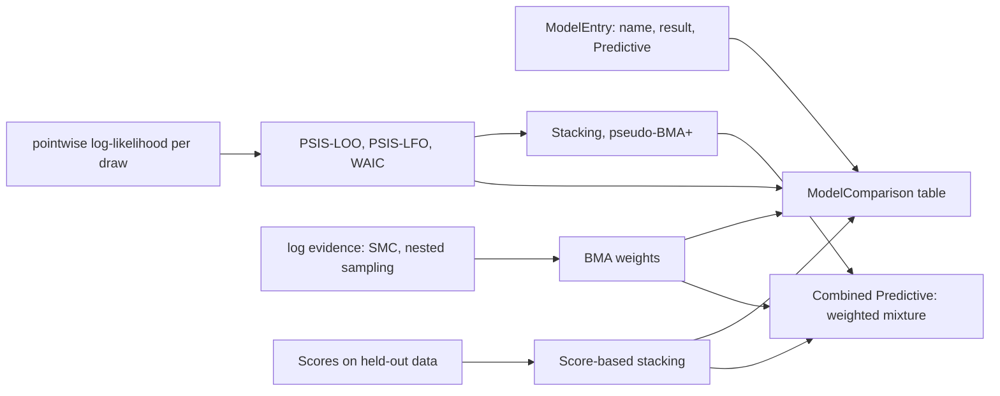

# Feature: model comparison and combination

Goal: compare models fitted to the same data (different processes, structures
or observation models) and combine their predictions: approximate
leave-one-out and leave-future-out cross-validation, WAIC, the evidence from
SMC and from nested sampling, Bayesian model averaging, stacking, and
score-based comparison that needs no noise model.
Motivation: uncertainty about which model is right is often larger than the
uncertainty inside one model; the user wants as many techniques as possible
(`inference-foundation.md` L2), and both families, with and without a noise
model (L3).
Program: thirteenth of fourteen; follows the architecture of
`odd/tasks/inference-foundation.md`; reads the pointwise likelihood of
`odd/tasks/observation-models.md`, the evidence of `odd/tasks/smc-inference.md`,
PSIS of `odd/tasks/local-approximations.md` and the kernels of
`odd/tasks/mcmc-samplers.md`.
Branch: `feat/model-comparison` from `develop`, after
`sensitivity-analysis.md` is merged.
Engram mirror: topic `odd/model-comparison/tasks` (project `commol`).
Runners: the Rust tests, clippy and rustdoc (from the root), `maturin develop
--release --features test-kind`, then `pytest`, `pytest -m docs`, `ruff check
.`, `ty check commol` and `vulture` (from `py-commol/`), `mkdocs build
--strict` (from the root).

## Current state (verified 2026-10-15 on `develop` at `20a61a6`)

- No code compares or combines models.
- After the earlier ODDs: `pointwise_log_likelihood`, `SmcResult.log_evidence`,
  PSIS with `k̂`, kernels and `ChainRunner`, `Predictive`, `commol.scores`
  (CRPS, WIS, log score).

## Architecture

- A `ModelEntry` names a fitted model and holds what the criteria read; each
  criterion reads only what it needs and reports when an entry lacks it (no
  pointwise likelihood for a loss-only fit).
- A combination is a `Predictive` (a weighted mixture of the entries'
  draws), so plots, reports and scores accept it with no change.
- `NestedSampler` is a sampler of its own whose moves are the `Kernel`s of
  `mcmc-samplers.md`, constrained to the current likelihood level.

## Specs

Every spec follows the [documentation definition of done](../../docs/codebase/conventions.md#documentation-definition-of-done).

### S1 — Predictive criteria

- Fix: `psis_loo(entry)` (Vehtari, Gelman and Gabry 2017): expected log
  predictive density, its standard error, and the `k̂` of each observation;
  observations with `k̂ > 0.7` are listed for exact refits.
- Fix (D2): `psis_lfo(entry, start)` (Bürkner, Gabry and Vehtari 2020):
  leave-future-out for time series, refitting only when `k̂` passes the
  threshold.
- Fix: `waic(entry)`, reported next to LOO with the guide's warning on when it
  fails.
- Check: on a linear Normal model, PSIS-LOO equals exact LOO within error.

### S2 — Nested sampling

- Fix (D1): `NestedSampling(priors, live_points, kernel, stop)` (Skilling
  2006): live points from the prior, replacement by a constrained kernel move,
  the log evidence with its error, and a weighted `ParameterSample` of the
  posterior.
- Check: on a Gaussian target, the evidence equals the closed form within its
  reported error; on a two-mode target, both modes appear.

### S3 — Model weights

- Fix: Bayesian model averaging weights from log evidences and prior model
  probabilities (required, `"equal"` allowed); pseudo-BMA+ and stacking of
  predictive distributions from LOO (Yao et al. 2018).
- Fix: score-based stacking for entries with no likelihood: weights that
  minimize the mean CRPS (or WIS) of the mixture on held-out data.
- Check: with one model that generated the data and one that did not, every
  weight goes to the first as data grow; stacking of two complementary models
  gives both weight.

### S4 — Comparison and combination

- Fix (D3): `compare_models(entries, criteria, observations=None)` returns
  `ModelComparison`: one row per entry, one column per criterion, with
  standard errors and differences to the best. `combine(entries, weights)`
  returns a `Predictive`; `weights` is required (from S3 or the user's).
- Check: the comparison of a single entry has one row; a criterion an entry
  cannot give is reported as missing, with the reason.

### S5 — Documentation

- Fix: `docs/guide/uncertainty/model-comparison.md`: evidence against
  predictive criteria, why time series need leave-future-out, averaging
  against stacking, comparing loss-only fits by scores; rows in the table of
  `uncertainty/index.md`.
- Check: `pytest -m docs`, `mkdocs build --strict`.

## Decisions (the user's to make)

Each row says why the recommendation beats each alternative.

| ID | Spec | Question | Recommendation | Why, against each alternative | Status |
|---|---|---|---|---|---|
| D1 | S2 | Nested sampling in scope? | Yes, static, with constrained kernel moves. | Evidence from SMC only: SMC's evidence is good, but nested sampling is the reference in many fields and handles multimodal targets differently; two estimates check each other. Dynamic nested sampling: more efficient, more code; later. | proposed |
| D2 | S1 | Time series and LOO | PSIS-LFO next to LOO, with LOO's limits stated. | LOO only: leaving out a middle point uses the future to predict the past. Exact LFO only: one refit per step. | proposed |
| D3 | S4 | Combination weights: default? | Required. | Stacking by default: a modelling choice; BMA and stacking answer different questions (which model is true against which mixture predicts best). | proposed |

## Tasks

| ID | Specs | Task | Route | Commit |
|---|---|---|---|---|
| T1 | S1 | PSIS-LOO, PSIS-LFO, WAIC | direct | |
| T2 | S2 | Nested sampling | direct | |
| T3 | S3 | BMA, pseudo-BMA+, stacking, score-based stacking | direct | |
| T4 | S4 | `compare_models`, `combine` | direct | |
| T5 | S5 | Guide page | direct | |
| T6 | all | Final audit: every runner | direct | |

## Delivery

- Strategy: one PR to `develop`, squash-merged (`feat(inference): …`).
- Order: T1 → T2 → T3 → T4 → T5 → T6.
- Version impact: added.

## Evidence

(Filled during implementation.)

## Log

- L1 (user, 2026-10-15): see `inference-foundation.md` L1–L5.
