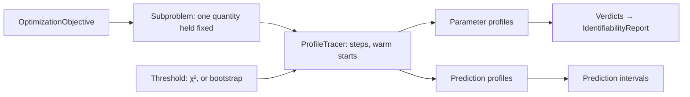

# Feature: profile likelihood of parameters and predictions

Goal: confidence intervals for each parameter and each prediction by fitting
again with that quantity held fixed, and a practical identifiability verdict
read from the shape of each profile.
Motivation: the profile likelihood is the standard tool for practical
identifiability (Raue et al. 2009), which the user added to the study
(`inference-foundation.md` L4). It also works with no noise model, as a
profile of the loss whose threshold comes from the bootstrap (L3).
Program: seventh of fourteen; follows the architecture of
`odd/tasks/inference-foundation.md`; uses the likelihood of
`odd/tasks/observation-models.md`, the bootstrap of
`odd/tasks/resampling-uncertainty.md`, and adds a section to the report of
`odd/tasks/identifiability.md`.
Branch: `feat/profile-likelihood` from `develop`, after
`observation-models.md` is merged.
Engram mirror: topic `odd/profile-likelihood/tasks` (project `commol`).
Runners: the Rust tests, clippy and rustdoc (from the root), `maturin develop
--release --features test-kind`, then `pytest`, `pytest -m docs`, `ruff check
.`, `ty check commol` and `vulture` (from `py-commol/`), `mkdocs build
--strict` (from the root).

## Current state (verified 2026-10-15 on `develop` at `20a61a6`)

- The optimizers fit every calibration parameter; none can be held fixed
  while the others move (`crates/commol-calibration/src/optimization.rs`).
- After the earlier ODDs: `OptimizationObjective`, `Likelihood`,
  `BayesianBootstrap`, `IdentifiabilityReport`, `SensitivitySource`.

## Architecture

- `Subproblem` wraps an objective with one quantity held fixed: a parameter
  (removed from the free vector) or a prediction (held by a quadratic
  penalty whose weight grows until the prediction is met). It is an
  objective like any other, so any optimizer runs it.
- `ProfileTracer` walks one quantity in both directions; it knows no
  optimizer and no threshold rule.
- `Threshold` is a port: `ChiSquare(level)` with a likelihood,
  `BootstrapCalibrated(bootstrap)` with a loss.

## Specs

Every spec follows the [documentation definition of done](../../docs/codebase/conventions.md#documentation-definition-of-done).

### S1 — Holding a quantity fixed

- Fix: `Subproblem::fix_parameter(j, value)` and
  `Subproblem::fix_prediction(spec, value)`, where `spec` is an observed
  quantity (an output at a position, with sums, windows and factors) read
  through `ObservationOperator`.
- Check: fixing a parameter at its fitted value refits to the same loss;
  fixing a prediction at its fitted value refits to the same parameters.

### S2 — Parameter profiles

- Fix (D2): `ProfileTracer` steps from the fit in each direction with the
  adaptive step of Raue et al. (2009): the step grows while the profile rises
  slowly and shrinks when it jumps; each point starts from the previous
  point's free parameters; it stops past the threshold, at a bound, or after
  `max_steps`. Parameters run in parallel.
- Fix (D1): with observation models, the threshold is
  `½ · χ²₁(level)` on `−log L` (pointwise intervals). With a loss only,
  `Threshold.bootstrap_calibrated(bootstrap)` sets the threshold so that the
  profile interval of each parameter matches the coverage of the bootstrap
  replicates (the loss increase that the refit of each replicate's data
  produces at the fit, at the level's quantile). `Threshold.beale(level)`, the
  F threshold for sums of squares, is offered and documented as assuming
  independent Gaussian errors.
- Check: on a linear Normal model, profile intervals equal the exact ones;
  the trace of a two-parameter model draws the expected parabola.

### S3 — Prediction profiles

- Fix: `PredictionProfile(spec)` profiles the value of a prediction (Kreutz et
  al. 2012): the interval of a prediction is the set of values the data do
  not reject. A list of specs gives a band at several positions.
- Check: on a linear Normal model, the prediction interval equals the
  analytic confidence interval of the mean.

### S4 — Verdicts

- Fix: each parameter profile is `identifiable` (it crosses the threshold on
  both sides), `practically_non_identifiable` (it stays below the threshold on
  at least one side, up to a bound) or `structurally_non_identifiable` (flat
  within numerical error over its whole range). The verdicts go to the
  `profile` section of `IdentifiabilityReport`.
- Check: the product model of `identifiability.md` S2 gives flat profiles for
  `k` and `f`; a model whose data stop before a parameter matters gives a
  one-sided profile.

### S5 — Results and documentation

- Fix: `ProfileLikelihood(parameters, threshold, max_steps)` and
  `PredictionProfile(specs, threshold)` through `Calibrator.uncertainty`;
  `ProfileResult(profiles, intervals, verdicts)`. `SimulationPlotter` gains a
  plot of profiles.
- Fix: `docs/guide/uncertainty/profiles.md`: how to read a profile, the
  threshold options and their assumptions, prediction profiles; rows in the
  table of `uncertainty/index.md`.
- Check: `pytest -m docs`, `mkdocs build --strict`.

## Decisions (the user's to make)

Each row says why the recommendation beats each alternative.

| ID | Spec | Question | Recommendation | Why, against each alternative | Status |
|---|---|---|---|---|---|
| D1 | S2 | Threshold without a noise model | Calibrated by the bootstrap; Beale's F threshold offered and labelled. | Only with a likelihood: drops the user's case of no noise model (`inference-foundation.md` L3). Beale only: assumes independent Gaussian errors without saying so. | proposed |
| D2 | S2 | How to step? | The adaptive step of Raue et al. (2009). | A fixed grid: too coarse near the fit or too slow far from it, and blind to jumps. | proposed |
| D3 | S3 | Prediction profiles in scope? | Yes. | Parameter profiles only: the user cannot get a band of predictions with this method, the more useful output. | proposed |
| D4 | S1 | Which optimizer runs a subproblem? | The problem's own. | Nelder-Mead always: fails on a profile that crosses a ridge the problem's optimizer was chosen for. | proposed |

## Tasks

| ID | Specs | Task | Route | Commit |
|---|---|---|---|---|
| T1 | S1 | `Subproblem` | direct | |
| T2 | S2 | `ProfileTracer`, thresholds | direct | |
| T3 | S3 | Prediction profiles | direct | |
| T4 | S4 | Verdicts, report section | direct | |
| T5 | S5 | Results, plot, guide page, coverage studies | direct | |
| T6 | all | Final audit: every runner | direct | |

## Delivery

- Strategy: one PR to `develop`, squash-merged (`feat(inference): …`).
- Order: T1 → T2 → T3 → T4 → T5 → T6.
- Version impact: added.

## Evidence

(Filled during implementation.)

## Log

- L1 (user, 2026-10-15): see `inference-foundation.md` L1–L5; this ODD
  answers L4 (practical identifiability) and L3 (a loss-only variant).
