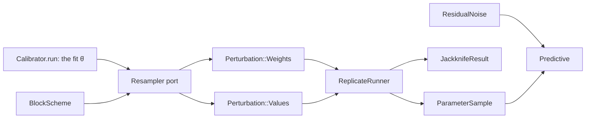

# Feature: uncertainty by resampling the data

Goal: parameter and prediction uncertainty with no noise model and no prior,
by fitting the model again to reweighted or resampled data: the Bayesian
(weighted) bootstrap, the residual and wild block bootstraps, and the block
jackknife.
Motivation: the user wants methods that need no a priori choice of the source
of uncertainty (`inference-foundation.md` L3). The weighted bootstrap is the
ensemble done right: the same parallel fits, each on randomly weighted data,
with a stated meaning and no selection by coverage.
Program: third of fourteen; follows the architecture of
`odd/tasks/inference-foundation.md`. The first release after that ODD waits
for this one (`inference-foundation.md` D2).
Branch: `feat/resampling-uncertainty` from `develop`, after
`identifiability.md` is merged.
Engram mirror: topic `odd/resampling-uncertainty/tasks` (project `commol`).
Runners: the Rust tests, clippy and rustdoc (from the root), `maturin develop
--release --features test-kind`, then `pytest`, `pytest -m docs`, `ruff check
.`, `ty check commol` and `vulture` (from `py-commol/`), `mkdocs build
--strict` (from the root).

## Current state (verified 2026-10-15 on `develop` at `20a61a6`)

- Each observation has a `weight`; `LossConfig::term` and `finish` apply it
  in every loss (`crates/commol-calibration/src/types.rs`;
  `docs/codebase/design-decisions.md`, "One meaning of an observation
  weight"). A reweighted fit is therefore a fit with other weights, with no
  new loss code.
- `run_multiple_calibrations` (`crates/commol-calibration/src/probabilistic/calibration.rs:43`)
  runs optimizations in parallel; `inference-foundation.md` S3 turns it into
  `Calibrator.run(starts=n)` and keeps the parallel runner.
- No code resamples data, groups observations into blocks, or estimates a
  block length.

## Architecture

- `BlockScheme` (`commol-inference/src/resampling/blocks.rs`) groups
  observations into blocks of consecutive positions. Every resampler, the
  folds of `conformal-prediction.md` and the dependence-robust covariance of
  `local-approximations.md` use it.
- `Resampler` is a port: `replicate(index, rng) -> Perturbation`, either new
  weights or new observed values. Each method below is one implementation.
- `ReplicateRunner` applies a perturbation to a copy of the problem, fits it
  and returns the result or the failure. It knows no resampler.
- `ResidualNoise` implements the `ObservationNoise` port of
  `inference-foundation.md` S6 with empirical residuals: the first prediction
  interval that needs no noise model.

## Specs

Every spec follows the [documentation definition of done](../../docs/codebase/conventions.md#documentation-definition-of-done).

### S1 — Blocks

- Fix (D2): a block holds every observation, of every series, whose position
  falls in one window of `block_length` consecutive positions, so the
  dependence across series and in time stays inside blocks.
- Fix (D3): `block_length` is required: an integer, or `"auto"`, which takes
  the rule of Politis and White (2004), with the correction of Patton,
  Politis and White (2009), on the residuals of the fit, the largest over
  series. The result reports the length used and, with `"auto"`, each
  series' estimate.
- Check: blocks cover every observation once; `"auto"` gives 1 on white-noise
  residuals and grows with the autocorrelation of AR(1) residuals.

### S2 — Bayesian (weighted) bootstrap

- Fix (D4): replicate `b` draws one Dirichlet(1, …, 1) weight per block,
  scaled by the number of blocks, multiplies the weight of each observation of
  the block by it, and fits. With a loss (not a likelihood) this is the
  loss-likelihood bootstrap of Lyddon, Holmes and Walker (2019); with one
  observation per block, the Bayesian bootstrap of Rubin (1981) and the
  weighted likelihood bootstrap of Newton and Raftery (1994).
- Fix: `BayesianBootstrap(replicates, block_length, starts=1)` returns
  `BootstrapResult(fit, sample, diagnostics)` with equal weights.
- Check: on a linear model with independent Gaussian noise, the sample's
  variance equals the sandwich variance of least squares within Monte Carlo
  error; coverage study (`coverage_study`) at 90 % and 95 % on a long series.

### S3 — Residual block bootstrap

- Fix (D5): residuals of the fit on the scale the user names, required:
  `residual_scale="additive"` (`r = y − ŷ`) or `"multiplicative"`
  (`r = log(y / ŷ)`, which needs positive values and says so when it fails).
- Fix: replicate `b` builds a new series by joining blocks of residuals drawn
  with replacement, as moving blocks (Künsch 1989) or stationary blocks with
  geometric lengths (Politis and Romano 1994), set by `scheme`, and fits
  `ŷ + r*` or `ŷ · exp(r*)`.
- Fix (D6): a synthetic value below zero is kept and counted in the
  diagnostics; the guide explains when to use the multiplicative scale.
- Check: the residuals of an exact fit give a sample of one point; coverage
  study with AR(1) noise, where the block version keeps the nominal level and
  the version with `block_length=1` falls below it.

### S4 — Wild block bootstrap

- Fix: replicate `b` multiplies the residuals of each block by one draw of a
  Rademacher or Mammen variable (`multipliers`, required) and fits
  `ŷ + r · v`. It keeps each residual at its own position, so it holds under
  noise whose size changes along the series.
- Check: coverage study with noise whose standard deviation grows with the
  model value, where the wild version keeps the nominal level and the
  residual bootstrap of S3 does not.

### S5 — Block jackknife

- Fix (D7): `BlockJackknife(block_length)` fits once per left-out block and
  returns `JackknifeResult`: the estimate, the jackknife bias and standard
  error of each parameter, the pseudo-values, and the influence of each block
  (how far leaving it out moves each parameter, in standard errors).
- Check: on the sample mean of independent values, the jackknife standard
  error equals the classical one.

### S6 — The replicate runner

- Fix (D1): each replicate starts from the fit `θ̂` and, with `starts > 1`,
  also from Latin-hypercube starts (`inference-foundation.md` D9); it keeps the
  best end.
- Fix: replicates run in parallel; a failed replicate goes to
  `diagnostics.failed` with its reason; a replicate that does not converge is
  kept and counted. The diagnostics also give the Monte Carlo error of each
  reported quantile (an order-statistic interval).
- Check: two runs with one seed are equal; a replicate made to fail appears
  in the diagnostics and not in the sample.

### S7 — Prediction intervals without a noise model

- Fix: `BootstrapResult.predictive(positions, noise)`, where `noise` is
  `NoNoise()` (the band of the model) or `ResidualNoise()` (adds block
  residuals of the fit to each draw's trajectory: a prediction interval).
- Check: the coverage of held-out observations by the residual prediction
  interval is near its nominal level in a coverage study; the band of the
  model alone is narrower.

### S8 — Documentation

- Fix: `docs/guide/uncertainty/resampling.md`: what each method assumes and
  answers, how to choose the block length and scale, why short series give
  unstable intervals; rows in the table of `uncertainty/index.md`; the
  changelog entry that maps `run_probabilistic` here.
- Check: `pytest -m docs`, `mkdocs build --strict`.

## Decisions (the user's to make)

Each row says why the recommendation beats each alternative.

| ID | Spec | Question | Recommendation | Why, against each alternative | Status |
|---|---|---|---|---|---|
| D1 | S6 | Where does each replicate start? | At the fit `θ̂`, plus optional Latin-hypercube starts. | Random starts only: each replicate may land in another basin, which adds optimizer noise to the data's uncertainty. `θ̂` only, always: fast, but blind to a second basin; `starts` lets the user check. | proposed |
| D2 | S1 | Blocks per series or across series? | Across series: one block holds every series in a window of positions. | Per series: breaks the dependence between series observed at the same time, so intervals of combined quantities come out too narrow. | proposed |
| D3 | S1 | Block length: default or required? | Required: an integer or `"auto"` (Politis–White). | A default `"auto"`: a choice the user may not know was made; asking costs one word. A fixed default length: wrong for most series. | proposed |
| D4 | S2 | Dirichlet concentration | 1 (Rubin's Bayesian bootstrap), fixed. | A user setting: changes the spread with no clear meaning; the literature uses 1. | proposed |
| D5 | S3 | Residual scale: default or required? | Required: `"additive"` or `"multiplicative"`. | Additive by default: wrong for counts that span orders of magnitude, a modelling choice. | proposed |
| D6 | S3 | A synthetic value below zero | Keep it and count it. | Clip to zero: biases the replicates up. Reject and redraw: changes the resampling distribution. The count tells the user to use the multiplicative scale. | proposed |
| D7 | S5 | Jackknife result | Its own `JackknifeResult`, with no `ParameterSample`. | Pseudo-values in a `ParameterSample`: their percentiles are not an interval (they need the `(n − 1)` scaling), so every reader would misread them. | proposed |

## Tasks

| ID | Specs | Task | Route | Commit |
|---|---|---|---|---|
| T1 | S1 | `BlockScheme`, `"auto"` length | direct | |
| T2 | S6 | `Resampler` port, `Perturbation`, `ReplicateRunner` | direct | |
| T3 | S2 | Bayesian bootstrap | direct | |
| T4 | S3, S4 | Residual and wild block bootstraps | direct | |
| T5 | S5 | Block jackknife | direct | |
| T6 | S7 | `ResidualNoise`, predictive of a bootstrap | direct | |
| T7 | S8 | Guide page, coverage studies, changelog | direct | |
| T8 | all | Final audit: every runner | direct | |

## Delivery

- Strategy: one PR to `develop`, squash-merged (`feat(inference): …`).
- Order: T1 → T2 → T3 → T4 → T5 → T6 → T7 → T8.
- Version impact: added. A release may follow (`inference-foundation.md` D2).

## Evidence

(Filled during implementation.)

## Log

- L1 (user, 2026-10-15): see `inference-foundation.md` L1–L5; this ODD
  answers L3.
