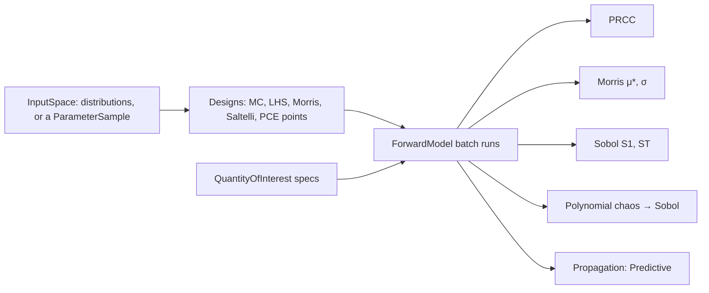

# Feature: uncertainty propagation and global sensitivity analysis

Goal: show how uncertainty in the inputs of a model moves its outputs
(forward uncertainty), and which inputs matter most, with no data needed:
Monte Carlo propagation, Latin hypercube sampling with partial rank
correlation (LHS-PRCC), Morris screening, Sobol indices and polynomial chaos.
Motivation: the user wants as many uncertainty techniques as possible
(`inference-foundation.md` L2). Calibration asks which inputs fit the data;
this ODD asks the forward question, and can start from the posterior that
calibration gives.
Program: twelfth of fourteen; follows the architecture of
`odd/tasks/inference-foundation.md`; reuses `Distribution`
(`odd/tasks/smc-inference.md`) and `Predictive`.
Branch: `feat/sensitivity-analysis` from `develop`, after
`state-space-inference.md` is merged.
Engram mirror: topic `odd/sensitivity-analysis/tasks` (project `commol`).
Runners: the Rust tests, clippy and rustdoc (from the root), `maturin develop
--release --features test-kind`, then `pytest`, `pytest -m docs`, `ruff check
.`, `ty check commol` and `vulture` (from `py-commol/`), `mkdocs build
--strict` (from the root).

## Current state (verified 2026-10-15 on `develop` at `20a61a6`)

- No sensitivity analysis exists. `docs/guide/probabilistic-calibration.md`
  ("Your own ensemble statistics") shows users simulating members in a
  Python loop and reducing each run themselves.
- After the earlier ODDs: `Distribution`, `ParameterSample`, `Predictive`
  (parallel trajectories in Rust), `ForwardModel`.

## Architecture

- `InputSpace` describes what varies: independent `Distribution`s per
  parameter, or a `ParameterSample` (dependent, weighted).
- `QuantityOfInterest` specs reduce each run to scalars in Rust, so designs of
  thousands of runs stay in Rust; a time-resolved analysis takes a
  quantity at every position.
- A design and an estimator are separate: each method is a pair, and the
  batch runner is shared.

## Specs

Every spec follows the [documentation definition of done](../../docs/codebase/conventions.md#documentation-definition-of-done).

### S1 — Inputs and quantities of interest

- Fix: `InputSpace.independent({parameter: Distribution})`,
  `InputSpace.from_sample(sample)`, and `InputSpace.uniform_on_bounds(problem)`.
  Inputs may include initial-condition values, read by the problem's value
  writer.
- Fix (D1): `QuantityOfInterest`: `ValueAt(output, position)`,
  `WindowSum(output, start, end)`, `Peak(output, start, end)`,
  `PeakPosition(output, start, end)`, `Final(output)`, and `Trajectory(output)`
  (one quantity per position). Outputs include sums of outputs, as
  observations do.
- Check: each quantity equals a hand computation on a known trajectory.

### S2 — Propagation

- Fix: `Propagation(inputs, draws, positions)` gives a `Predictive` of the
  input draws, so its bands, plots and reports are the ones of calibration.
- Check: with a sample as input, it equals the predictive of that sample.

### S3 — LHS-PRCC

- Fix: `Prcc(inputs, draws, quantities)` (Marino et al. 2008): a Latin
  hypercube design, rank transforms, partial correlations with their
  significance; time-resolved with `Trajectory`.
- Check: on `y = a·x1 + x2³` with independent inputs, both PRCCs are near 1
  and a dummy input near 0.

### S4 — Morris screening

- Fix: `Morris(inputs, trajectories, levels)` (Morris 1991, with the `μ*` of
  Campolongo, Cariboni and Saltelli 2007): elementary effects along
  trajectories, `μ*` and `σ` per input.
- Check: on the Sobol g-function, the ranking of `μ*` matches the known
  importance.

### S5 — Sobol indices

- Fix (D3): `Sobol(inputs, base_draws, quantities)`: the Saltelli (2010)
  design, first-order indices by Saltelli's estimator and total indices by
  Jansen's (1999), with bootstrap intervals. Requires independent inputs; an
  `InputSpace.from_sample` raises and points to PRCC and propagation.
- Check: on the Ishigami function, indices equal the analytic values within
  their intervals.

### S6 — Polynomial chaos

- Fix (D2): `PolynomialChaos(inputs, degree, draws)`: orthogonal polynomials
  matched to each input distribution (Legendre for uniform, Hermite for
  normal; other distributions through their quantile transform to uniform),
  a total-degree basis, coefficients by least squares on a Latin hypercube
  design, a leave-one-out error, and Sobol indices from the coefficients
  (Sudret 2008). The fitted expansion is returned as a cheap surrogate that
  `emulation-discrepancy.md` can compare with its emulators.
- Check: on the Ishigami function, indices within tolerance of the analytic
  values with fewer runs than S5.

### S7 — Entry point and documentation

- Fix (D4): `SensitivityAnalysis(simulation).run(method)`, generic in the
  result type with a registry (the pattern of `inference-foundation.md` S8),
  since no problem or data is needed. Results: `PrccResult`, `MorrisResult`,
  `SobolResult`, `ChaosResult`; plots: PRCC over time, `μ*` against `σ`, Sobol
  bars.
- Fix: `docs/guide/uncertainty/sensitivity.md`: forward against inverse
  questions, which method for which budget, why Sobol needs independent
  inputs; rows in the table of `uncertainty/index.md`; the example of
  reducing each member to a quantity, which left with
  `probabilistic-calibration.md` (`inference-foundation.md` S10), comes back
  as propagation with quantities of interest.
- Check: `pytest -m docs`, `mkdocs build --strict`.

## Decisions (the user's to make)

Each row says why the recommendation beats each alternative.

| ID | Spec | Question | Recommendation | Why, against each alternative | Status |
|---|---|---|---|---|---|
| D1 | S1 | How does a user name what to analyse? | Typed quantity-of-interest specs, evaluated in Rust. | Python callables: any quantity, but every run returns to Python, which serializes thousands of runs on the GIL. Both: a second path with different speed and behaviour; specs can grow when a need appears. | proposed |
| D2 | S6 | Polynomial chaos in scope? | Yes, as the last task. | Out: Sobol by Monte Carlo covers the indices, but costs far more runs for slow models (agents), where the surrogate pays. | proposed |
| D3 | S5 | Sobol with dependent inputs (a posterior)? | Refuse, and point to PRCC and propagation. | Compute them anyway: the indices lose their meaning and their sum. Shapley effects: the right tool for dependence, but costly and a larger piece; a later ODD can add them. | proposed |
| D4 | S7 | Entry point | `SensitivityAnalysis(simulation).run(method)`. | `Calibrator.uncertainty`: needs a problem with data, which a forward analysis does not have. Free functions: repeat the simulation argument. | proposed |

## Tasks

| ID | Specs | Task | Route | Commit |
|---|---|---|---|---|
| T1 | S1 | `InputSpace`, quantities of interest, batch runner | direct | |
| T2 | S2 | Propagation | direct | |
| T3 | S3 | LHS-PRCC | direct | |
| T4 | S4 | Morris | direct | |
| T5 | S5 | Sobol | direct | |
| T6 | S6 | Polynomial chaos | direct | |
| T7 | S7 | Entry point, plots, guide page | direct | |
| T8 | all | Final audit: every runner | direct | |

## Delivery

- Strategy: one PR to `develop`, squash-merged (`feat(analysis): …`).
- Order: T1 → T2 → T3 → T4 → T5 → T6 → T7 → T8.
- Version impact: added.

## Evidence

(Filled during implementation.)

## Log

- L1 (user, 2026-10-15): see `inference-foundation.md` L1–L5.
