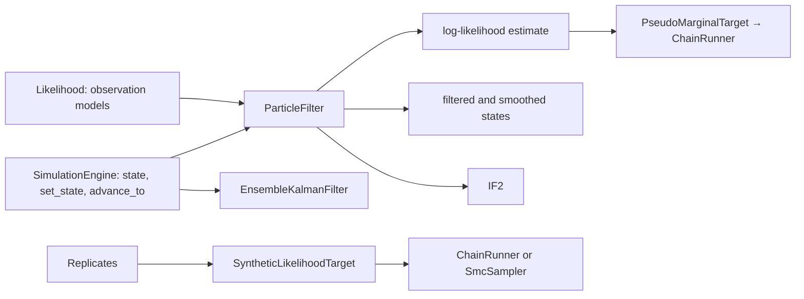

# Feature: state-space inference for stochastic models

Goal: likelihood-based inference for stochastic models, where the likelihood
has no closed form: the bootstrap particle filter, particle marginal
Metropolis–Hastings (PMMH), iterated filtering (IF2), ensemble Kalman
filters (EnKF, EAKF), and the synthetic likelihood.
Motivation: `model-kind-foundation.md` S7 leaves particle filters to their own
ODD once a stochastic engine exists. The user wants as many methods as
possible (`inference-foundation.md` L2), and the closest library, odin2 +
dust2 + monty, calibrates with particle filters and MCMC
(`library-benchmark.md`, Context).
Program: eleventh of fourteen; follows the architecture of
`odd/tasks/inference-foundation.md`; needs the engines of
`odd/tasks/stochastic-compartmental.md`, the likelihood of
`odd/tasks/observation-models.md` and the chains of
`odd/tasks/mcmc-samplers.md`.
Branch: `feat/state-space-inference` from `develop`, after
`gradient-inference.md` is merged.
Engram mirror: topic `odd/state-space-inference/tasks` (project `commol`).
Runners: the Rust tests, clippy and rustdoc (from the root), `maturin develop
--release --features test-kind`, then `pytest`, `pytest -m docs`, `ruff check
.`, `ty check commol` and `vulture` (from `py-commol/`), `mkdocs build
--strict` (from the root).

## Current state (verified 2026-10-15 on `develop` at `20a61a6`)

- `SimulationEngine` (`crates/commol-core/src/simulation_engine.rs:133`) can
  `step`, `reset`, report `current_position`, and run to positions. It cannot
  return its state or start from a given one, so a filter cannot stop all
  particles at an observation, resample them and continue.
- After the earlier ODDs: `set_seed` and `commol-random`
  (`model-kind-foundation.md` S5), replicates with common random numbers
  (S6, S7), the stochastic engines (`stochastic-compartmental.md`),
  `Likelihood`, `Target`, `ChainRunner`, `SmcSampler`.

## Architecture

- Three engine methods are the only new contract; every engine (deterministic
  and stochastic, aggregate now, network and agents later) implements them,
  so every filter runs on every engine.
- `ParticleFilter` returns an estimate and the particle paths; PMMH wraps the
  estimate as a `Target` whose value is noisy, so the chain code is reused.
- IF2 and the ensemble Kalman filters are filters too; they reuse the
  contract and the observation models, not the particle filter.

## Specs

Every spec follows the [documentation definition of done](../../docs/codebase/conventions.md#documentation-definition-of-done).

### S1 — The engine contract

- Fix (D1): `SimulationEngine::state(&self) -> Vec<f64>` (the amounts, the
  accumulators and the generator's state), `set_state(&mut self, &[f64])`, and
  `advance_to(&mut self, position) -> Result<(), SimulationError>`. Each engine
  implements them; the ODE engine restarts its solver at `set_state`.
- Check: for every engine, `state`, `set_state` and `advance_to` in pieces
  give the same trajectory as one run; a stochastic engine continued from a
  saved state with its generator gives the same draws.

### S2 — Bootstrap particle filter

- Fix (D2): `ParticleFilter(particles, resample_threshold)`: advances every
  particle to the next observation, weights it by the likelihood of the
  observation, resamples (systematic) when the effective size falls below the
  threshold, and returns the log-likelihood estimate (unbiased for the
  likelihood) and the filtered states. `smooth=True` keeps ancestors and
  returns smoothed paths.
- Fix: particles advance in parallel, each with its own stream.
- Check (D5): on the linear Gaussian test engine (added to the test kind),
  the mean of many estimates of the likelihood equals the Kalman filter's
  exact value; the variance of the log estimate falls as particles grow.

### S3 — PMMH

- Fix: `Pmmh(priors, particles, kernel, chains, warmup, draws)`: a chain whose
  target is the particle estimate (Andrieu, Doucet and Holenstein 2010);
  `correlated=True` moves the random numbers of the filter with a
  Crank–Nicolson step (Deligiannidis, Doucet and Pitt 2018), so fewer
  particles suffice. The diagnostics report the variance of the log estimate
  at the posterior mean, with the guide's rule (near 1).
- Check: on the linear Gaussian test engine, PMMH matches the exact
  posterior of the Kalman likelihood; coverage study on a stochastic SIR.

### S4 — IF2

- Fix: `IteratedFiltering(particles, iterations, perturbation, cooling)`
  (Ionides et al. 2015): filters with parameters that random-walk and shrink
  their steps, converging to the maximum likelihood estimate. Returns the
  estimate and the log-likelihood trace; profile intervals can follow with
  `profile-likelihood.md`'s tracer on the particle estimate.
- Check: on the linear Gaussian test engine, the estimate approaches the
  exact maximum as iterations grow.

### S5 — Ensemble Kalman filters

- Fix (D3): `EnsembleKalman(members, variant, inflation)` with `variant`
  `"eakf"` (Anderson 2001) or `"stochastic"` (perturbed observations), on the
  state augmented with the parameters (Shaman and Karspeck 2012). It works
  with deterministic and stochastic engines and returns filtered states and
  parameters at each observation.
- Check: in the linear Gaussian case, a large ensemble gives the Kalman
  filter's mean and variance.

### S6 — Synthetic likelihood

- Fix (D4): `SyntheticLikelihood(replicates)`: at each `θ`, runs `replicates`
  replicates with common random numbers, fits a Gaussian to the simulated
  observed quantities (the observations themselves, the default summary), and
  returns its log density at the data (Wood 2010; the Bayesian form of Price
  et al. 2018). It is a `Target`, for the chain runner and the SMC core.
- Check: on a model whose observed quantities are Gaussian, it equals the
  exact likelihood as replicates grow.

### S7 — Documentation

- Fix: `docs/guide/uncertainty/state-space.md`: when the likelihood needs a
  filter, choosing the number of particles, PMMH against IF2 against EnKF,
  what the synthetic likelihood assumes; rows in the table of
  `uncertainty/index.md`; `design-decisions.md` gets "Engines expose their
  state"; `maintainer-playbook.md` adds the three methods to the engine
  checklist.
- Check: `pytest -m docs`, `mkdocs build --strict`.

## Decisions (the user's to make)

Each row says why the recommendation beats each alternative.

| ID | Spec | Question | Recommendation | Why, against each alternative | Status |
|---|---|---|---|---|---|
| D1 | S1 | How does a filter continue a run? | `state`, `set_state` and `advance_to` on every engine. | Clone the engine per particle and run each interval from the start: cost grows with the square of the number of observations. Only stochastic engines: EnKF on a deterministic model would be impossible. | proposed |
| D2 | S2 | Which particle filter? | The bootstrap filter. | Auxiliary or guided filters: better proposals, but they need model-specific densities commol cannot derive in general. | proposed |
| D3 | S5 | Which ensemble Kalman filter? | Both EAKF and the stochastic EnKF, chosen by `variant`. | EAKF only: the stochastic variant is the reference in much of the literature and simple to add. Stochastic only: more sampling noise for small ensembles, which EAKF avoids. | proposed |
| D4 | S6 | Summaries of the synthetic likelihood | The observed quantities themselves. | User summaries: the same typed language that ABC lacks (`smc-inference.md` D4); both can gain it together later. | proposed |
| D5 | S2 | Which oracle tests the filters? | A linear Gaussian engine in the test kind, checked against the Kalman filter. | Only stochastic SIR models: no exact likelihood to compare with. | proposed |

## Tasks

| ID | Specs | Task | Route | Commit |
|---|---|---|---|---|
| T1 | S1 | Engine contract in every engine; linear Gaussian test engine | direct | |
| T2 | S2 | Particle filter, smoothing | direct | |
| T3 | S3 | PMMH, correlated PMMH | direct | |
| T4 | S4 | IF2 | direct | |
| T5 | S5 | EAKF and stochastic EnKF | direct | |
| T6 | S6 | Synthetic likelihood | direct | |
| T7 | S7 | Guide page, design decision, coverage studies | direct | |
| T8 | all | Final audit: every runner | direct | |

## Delivery

- Strategy: one PR to `develop`, squash-merged (`feat(inference): …`).
- Order: T1 → T2 → T3 → T4 → T5 → T6 → T7 → T8.
- Version impact: added; the engine contract grows (an addition for engines
  outside commol, none exist).

## Evidence

(Filled during implementation.)

## Log

- L1 (user, 2026-10-15): see `inference-foundation.md` L1–L5;
  `model-kind-foundation.md` S7 points here for particle filters.
