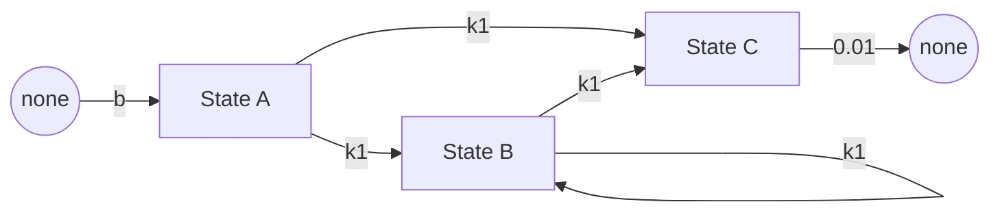
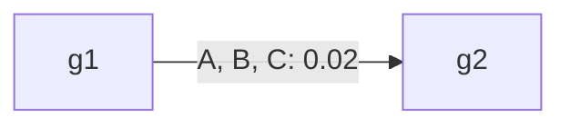

# Every flow

## Overview

| Field | Value |
|---|---|
| Name | Every flow |
| Version | 1.0 |
| Kind | aggregate |
| Engine | DifferenceEquations |
| Engine settings | defaults |
| Dynamics | difference equation |
| Step unit | step |

## Entities and state variables

### Bins

| Bin | Name | Unit |
|---|---|---|
| A | State A |  |
| B | State B |  |
| C | State C |  |

### Stratifications

| Stratification | Categories | Splits |
|---|---|---|
| group | g1, g2 | every compartment |

### Compartments

| Compartment | Bin | Categories |
|---|---|---|
| A_g1 | A | group=g1 |
| A_g2 | A | group=g2 |
| B_g1 | B | group=g1 |
| B_g2 | B | group=g2 |
| C_g1 | C | group=g1 |
| C_g2 | C | group=g2 |

## Dynamics

### States and transitions

### Moves between categories

### Expanded compartments

The graph of the expanded compartments has 6 nodes and 25 edges; it is not drawn here. `description.save("model.dot")` writes it as Graphviz DOT.

### Compact form

**Bin Transitions**

`pair (A, B -> C)`

$$
\begin{aligned}
A_{g1} \to C_{g1} &: k1 \cdot A \cdot B \\
B_{g1} \to C_{g1} &: k1 \cdot A \cdot B \\
A_{g2} \to C_{g2} &: k1 \cdot A \cdot B \\
B_{g2} \to C_{g2} &: k1 \cdot A \cdot B
\end{aligned}
$$

`spread (A, B -> B)`

$$
\begin{aligned}
A_{g1} \to B_{g1} &: \frac{k1 \cdot A \cdot B}{total} \\
B_{g1} \to B_{g1} &: \frac{k1 \cdot A \cdot B}{total} \\
A_{g2} \to B_{g2} &: \frac{k1 \cdot A \cdot B}{total} \\
B_{g2} \to B_{g2} &: \frac{k1 \cdot A \cdot B}{total}
\end{aligned}
$$

`split (A -> B, C)`

$$
\begin{aligned}
A_{g1} \to B_{g1} &: 0.05 \cdot A_{g1} \\
\varnothing \to C_{g1} &: 0.05 \cdot A_{g1} \\
A_{g2} \to B_{g2} &: 0.05 \cdot A_{g2} \\
\varnothing \to C_{g2} &: 0.05 \cdot A_{g2}
\end{aligned}
$$

`loop (B -> B)`

$$
\begin{aligned}
B_{g1} \to B_{g1} &: 0.1 \cdot B_{g1} \\
B_{g2} \to B_{g2} &: 0.1 \cdot B_{g2}
\end{aligned}
$$

`inflow (none -> A)`

$$
\begin{aligned}
\varnothing \to A_{g1} &: b \\
\varnothing \to A_{g2} &: b
\end{aligned}
$$

`dose (A -> B, impulse at 1, 3)`

$$
\begin{aligned}
A_{g1} \to B_{g1} &: 0.1 \cdot A_{g1} \\
A_{g2} \to B_{g2} &: 0.1 \cdot A_{g2}
\end{aligned}
$$

`outflow (C -> none)`

$$
\begin{aligned}
C_{g1} \to \varnothing &: 0.01 \cdot C_{g1} \\
C_{g2} \to \varnothing &: 0.01 \cdot C_{g2}
\end{aligned}
$$

`pending (A -> C)`

(none)

`boost (B -> C, impulse every 7 from 0)`

$$
\begin{aligned}
B_{g1} \to C_{g1} &: 0.5 \cdot B_{g1} \\
B_{g2} \to C_{g2} &: 0.5 \cdot B_{g2}
\end{aligned}
$$

**Group Stratification Transitions**

`move (g1 -> g2)`

$$
\begin{aligned}
A_{g1} \to A_{g2} &: 0.02 \cdot A_{g1} \\
B_{g1} \to B_{g2} &: 0.02 \cdot B_{g1} \\
C_{g1} \to C_{g2} &: 0.02 \cdot C_{g1}
\end{aligned}
$$

Total System: 6 coupled equations (3 bins × 2 group)

### Expanded form

$$
\begin{aligned}
\frac{A_{g1}(t+\Delta t) - A_{g1}(t)}{\Delta t} &= - (k1 \cdot A \cdot B) - (\frac{k1 \cdot A \cdot B}{total}) - (0.05 \cdot A_{g1}) + (b) - (0.02 \cdot A_{g1}) \\
\frac{A_{g2}(t+\Delta t) - A_{g2}(t)}{\Delta t} &= - (k1 \cdot A \cdot B) - (\frac{k1 \cdot A \cdot B}{total}) - (0.05 \cdot A_{g2}) + (b) + (0.02 \cdot A_{g1}) \\
\frac{B_{g1}(t+\Delta t) - B_{g1}(t)}{\Delta t} &= - (k1 \cdot A \cdot B) + (\frac{k1 \cdot A \cdot B}{total}) + (0.05 \cdot A_{g1}) - (0.02 \cdot B_{g1}) \\
\frac{B_{g2}(t+\Delta t) - B_{g2}(t)}{\Delta t} &= - (k1 \cdot A \cdot B) + (\frac{k1 \cdot A \cdot B}{total}) + (0.05 \cdot A_{g2}) + (0.02 \cdot B_{g1}) \\
\frac{C_{g1}(t+\Delta t) - C_{g1}(t)}{\Delta t} &= (2 \cdot k1 \cdot A \cdot B) + (0.05 \cdot A_{g1}) - (0.01 \cdot C_{g1}) - (0.02 \cdot C_{g1}) \\
\frac{C_{g2}(t+\Delta t) - C_{g2}(t)}{\Delta t} &= (2 \cdot k1 \cdot A \cdot B) + (0.05 \cdot A_{g2}) - (0.01 \cdot C_{g2}) + (0.02 \cdot C_{g1})
\end{aligned}
$$

### Impulses

`dose, impulse at 1, 3`

$$
\begin{aligned}
A_{g1} \to B_{g1} &: 0.1 \cdot A_{g1} \\
A_{g2} \to B_{g2} &: 0.1 \cdot A_{g2}
\end{aligned}
$$

`boost, impulse every 7 from 0`

$$
\begin{aligned}
B_{g1} \to C_{g1} &: 0.5 \cdot B_{g1} \\
B_{g2} \to C_{g2} &: 0.5 \cdot B_{g2}
\end{aligned}
$$

## Schedule

Each step applies every flow once, computed from the state at the start of the step: X(n + 1) = X(n) + sum of the flows. The impulses of a step act first, and its flows run from the new state.

## Initialization

### Bin amounts

| Bin | Amount | Unit |
|---|---|---|
| A | 500 |  |
| B | 500 |  |
| C | 0 |  |

### Stratification fractions

| Stratification | Category | Fraction | Of |
|---|---|---|---|
| group | g1 | 0.5 | each bin |
| group | g2 | 0.5 | each bin |

### Initial state

| Compartment | Amount | Unit |
|---|---|---|
| A_g1 | 250 |  |
| A_g2 | 250 |  |
| B_g1 | 250 |  |
| B_g2 | 250 |  |
| C_g1 | 0 |  |
| C_g2 | 0 |  |

## Parameters

| Parameter | Value | Unit | Set by calibration | Description |
|---|---|---|---|---|
| k1 | 0.001 |  | no |  |
| b | 1 |  | no |  |

## Outputs

| Source | Outputs |
|---|---|
| A | A_g1, A_g2 |
| B | B_g1, B_g2 |
| C | C_g1, C_g2 |
