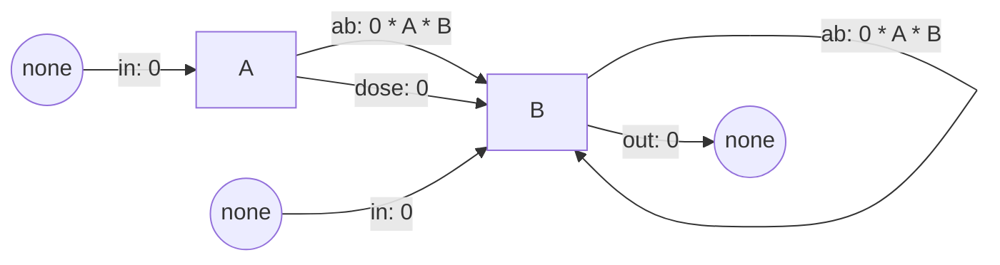

# At rest

## Purpose and patterns

Two bins at rest.

## Entities, state variables and scales

### Bins

| Bin | Name | Unit |
|---|---|---|
| A | A |  |
| B | B |  |

### Compartments

| Compartment | Bin | Categories |
|---|---|---|
| A | A |  |
| B | B |  |

### Scales

| Scale | Value |
|---|---|
| Axis | one step is 1 step |
| Advance | continuous (StochasticEvents) |

## Process overview and scheduling

### Processes

| Process | From | To | When |
|---|---|---|---|
| ab | A, B | B, B | every step |
| in | none | A, B | every step |
| out | B | none | every step |
| dose | A | B | impulse |

### Scheduling

Events happen one at a time, at random times: each event of a flow moves one unit from its sources to its targets, with a probability per unit of the axis (its propensity) of the rate times its source for a proportional rate, or the rate for an absolute one. The engine stops at each impulse, where the impulses act first, and at each position where a rate jumps.

### Settings

| Setting | Value |
|---|---|
| method | tau_leaping |
| tau | none |
| epsilon | 0.03 |
| tolerance | 1e-08 |
| rounding | none |

## Design concepts

| Element | Description |
|---|---|
| Basic principles | To be written by the modeller. |
| Emergence | To be written by the modeller. |
| Adaptation | To be written by the modeller. |
| Objectives | To be written by the modeller. |
| Learning | To be written by the modeller. |
| Prediction | To be written by the modeller. |
| Sensing | To be written by the modeller. |
| Interaction | A rate that reads neighbors_<bin> or neighbors depends on every unit: every unit is a neighbor of every other. |
| Stochasticity | The engine draws the events at random. |
| Collectives | To be written by the modeller. |
| Observation | A run returns the value of every output at every position it reports; the submodels list the outputs. |

## Initialization

### Bin amounts

| Bin | Amount | Unit |
|---|---|---|
| A | 5 |  |
| B | 5 |  |

### Initial state

| Compartment | Amount | Unit |
|---|---|---|
| A | 5 |  |
| B | 5 |  |

## Input data

None: the model reads no series of values.

## Submodels

### States and transitions

### Expanded compartments

The graph of the expanded compartments has 2 nodes and 6 edges; it is not drawn here. `description.save("model.dot")` writes it as Graphviz DOT.

### Compact form

**Bin Transitions**

`ab (A, B -> B)`

$$
\begin{aligned}
A \to B &: 0 \cdot A \cdot B \\
B \to B &: 0 \cdot A \cdot B
\end{aligned}
$$

`in (none -> A, B)`

$$
\begin{aligned}
\varnothing \to A &: 0 \\
\varnothing \to B &: 0
\end{aligned}
$$

`out (B -> none)`

$$
\begin{aligned}
B \to \varnothing &: 0 \cdot B
\end{aligned}
$$

`dose (A -> B, impulse at 1)`

$$
\begin{aligned}
A \to B &: 0 \cdot A
\end{aligned}
$$

Total System: 2 coupled equations (2 bins)

### Events

| Transition | Change | Propensity |
|---|---|---|
| ab | A -1, B +1 | 0 * A * B |
| in | A +1, B +1 | 0 |
| out | B -1 | 0 * B |

Each event moves one unit. A flow has no events while one of its sources holds fewer units than an event takes.

### Impulses

`dose, impulse at 1`

$$
\begin{aligned}
A \to B &: 0 \cdot A
\end{aligned}
$$

### Neighbors

Every unit is a neighbor of every other (Complete): neighbors_<bin> is the bin total and neighbors is total.

### Parameters

The model has no parameters.

### Outputs

| Source | Outputs |
|---|---|
| A | A |
| B | B |
